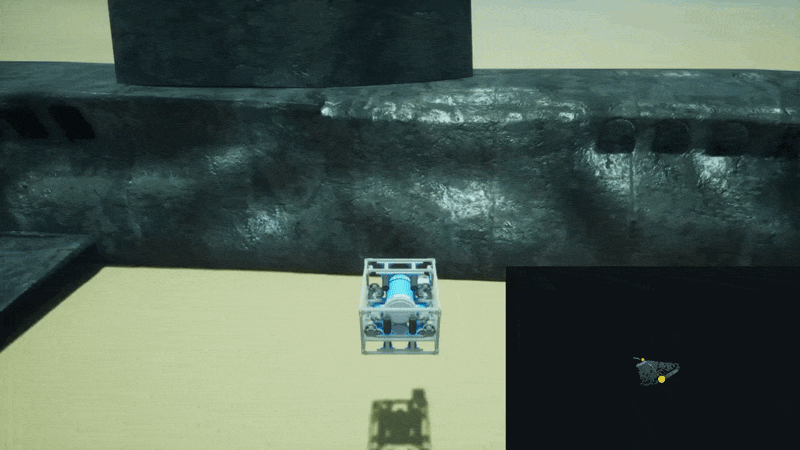
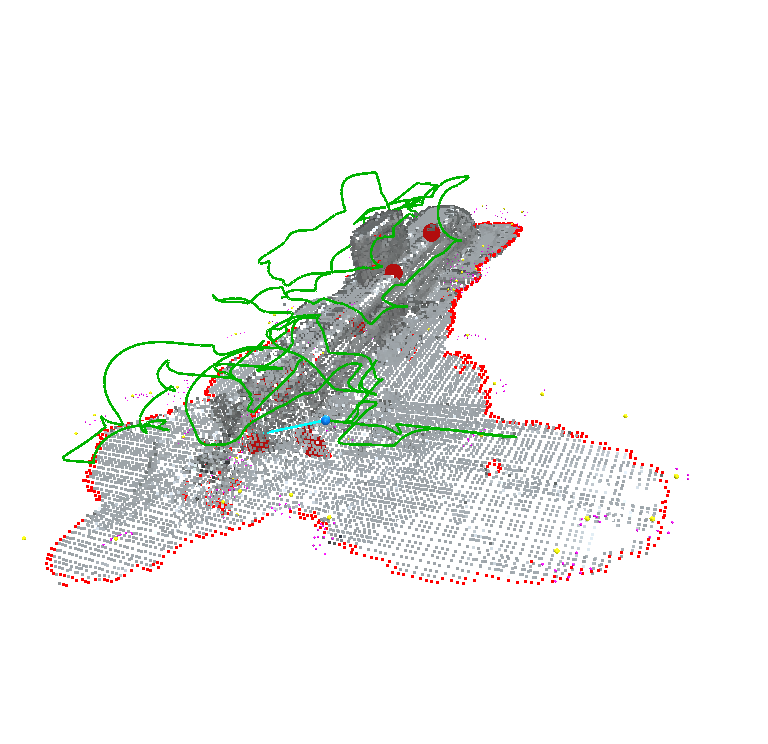
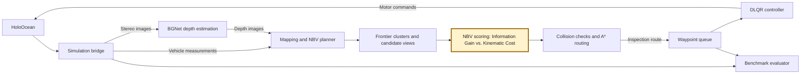

# NBV Underwater Inspection with ROS 2

A ROS 2 research workspace for **adaptive Next-Best-View (NBV) underwater
inspection** in HoloOcean. Unlike traditional pre-programmed "lawnmower" AUV
paths, this system chooses where to look next from real-time stereo
reconstruction, adapting its inspection route as complex, unstructured underwater
environments come into view. Structures such as pipe networks call for views
that reveal new surfaces and resolve geometric detail, rather than uniform
coverage alone. The research focus is an NBV engine that combines surface
frontiers, geometric complexity, and camera constraints with the cost of moving
the vehicle: each new observation informs which inspection pose is most useful
to pursue next. Collision-checked routing and motion control turn those choices
into an executable inspection mission.

The default deployment uses the **C++ inspection planner** and a **DLQR motion
controller**. A Python planner remains available as the migration reference.



*Example inspection route and reconstructed surface geometry from this workspace.*

## How it works

1. **Simulate and sense.** The HoloOcean bridge publishes stereo images,
   vehicle position, and navigation sensor measurements.
2. **Estimate depth.** BGNet estimates stereo disparity; the auv_stereo_depth pipeline
   converts it into depth for point-cloud reconstruction.
3. **Update the map.** The planner projects depth observations into world
   coordinates and maintains an OctoMap occupancy representation.
4. **Choose an inspection view.** Surface geometry, frontier clusters, estimated
   information gain, travel cost, and observation history determine NBV utility.
   Candidate views account for the upward-looking camera arrangement.
5. **Plan and execute.** Collision checks and A* routing connect reachable views.
   The waypoint queue feeds the DLQR controller, which sends motor commands
   back to the simulator.
6. **Observe and replan.** New measurements update the map and target history.
   The C++ planner tracks failed attempts, cooldowns, and recovery; the evaluator
   records executed motion and planning diagnostics.



## The Next-Best-View (NBV) Engine

The NBV engine turns reconstructed surface geometry into a ranked set of
inspection viewpoints. Its central question is which next observation offers
the most useful surface information for the motion it requires.

1. **Pre-processing.** Seafloor filtering separates inspection targets from
   background geometry, while voxel downsampling reduces the number of points
   processed. Outlier filtering cleans the surface cloud; a seabed-aware gain
   penalty further reduces the priority of near-floor surfaces.
2. **Frontier Detection.** For each surface neighborhood, the engine projects
   neighboring points onto a local 2D tangent plane and measures the angular
   gaps between them. Large gaps identify edges of the reconstructed surface,
   where known geometry borders space that needs further observation. These
   frontier points are grouped into target clusters.
3. **Feature Extraction (PCA).** Principal Component Analysis of local point
   neighborhoods uses covariance eigenvalues to estimate geometric complexity.
   The smallest eigenvalue relative to their sum measures variation away from
   a locally flat surface. This geometric signal increases the priority of
   complex structures, such as pipe joints or valves, over flat surfaces;
   it does not require semantic recognition of those objects.
4. **Viewpoint Generation.** Around each target cluster, the engine samples a
   cone of candidate camera poses at a configured safe standoff distance. The
   cone axis is locked to the upward-looking camera constraint, with azimuth
   selection accounting for surrounding geometry. Candidate and route collision
   checks determine whether those views can be safely approached.
5. **Utility Function.** Each candidate balances **Information Gain** against
   **Kinematic Cost**. Gain rewards favorable viewing incidence angles and
   weights the observed surfaces by PCA complexity. Cost combines travel
   distance, the turning required to travel and face the target, and a penalty
   for proximity to obstacles. The C++ planner applies eligibility and blacklist
   filtering before normalizing candidate scores, then ranks views by weighted
   normalized gain minus weighted normalized cost.

The selected views feed collision-checked routing and the waypoint queue. New
stereo observations update the map and inspection history, closing the loop
between reconstruction, view selection, and vehicle motion.

Planned improvements include more efficient routing and fewer false-positive
points in the reconstructed point cloud.

## License

Project-authored code and documentation are licensed under **Apache-2.0**;
see [LICENSE](LICENSE) and [NOTICE](NOTICE). Vendored SciPy (BSD-3-Clause) and
nlohmann/json (MIT) retain their own terms. BGNet and pretrained model-weight
permissions remain unverified and are excluded from the Apache-2.0 grant.
See [THIRD_PARTY_NOTICES.md](THIRD_PARTY_NOTICES.md) for component scope,
attribution, and the unresolved BGNet/model redistribution status.

## Workspace packages

| Package | Responsibility |
| --- | --- |
| `auv_bringup` | Full-system and planner-only launches; operational configuration |
| `auv_sim_bridge` | HoloOcean session, sensor publication, and motor-command input |
| `auv_stereo_depth` | Stereo synchronization, BGNet disparity, and depth estimation |
| `auv_inspection_planner` | Default C++ mapping, NBV selection, routing, and mission lifecycle |
| `auv_planner_reference` | Python reference implementation of the inspection pipeline |
| `auv_motion_control` | Waypoint queue, DLQR tracking, and thruster command generation |
| `auv_benchmark` | Trajectory metrics, controller response measurements, and plots |
| `auv_experiments` | Optuna experiment orchestration and parameter search |
| `auv_contracts` | Shared values, interfaces, and mission-result conventions |
| `auv_telemetry` | File sinks for planning and auv_stereo_depth telemetry |

## Prerequisites

The build and launch examples target **ROS 2 Jazzy on Linux**. The supplied
Open3D SDK bootstrap targets **Linux x86-64**. A simulator installation and
compatible Python environment must be prepared separately; this repository
does not provide a complete environment lockfile.

| Area | Required components |
| --- | --- |
| ROS build | ROS 2 Jazzy, colcon, rosdep, CMake, a C++17 compiler, and gfortran |
| C++ numerics and mapping | Eigen, PCL, OctoMap, OpenCV, BLAS/LAPACK, and the Open3D **0.19.0** C++ SDK |
| Python runtime | NumPy, SciPy, OpenCV, Pillow, PyTorch, torchvision, Matplotlib, and `control` |
| Reference and regression checks | Python Open3D, `pyoctomap`, and pytest |
| Experiment tuning | Optuna, pandas, and PyYAML |
| Simulation | An importable `holoocean` installation and the world packages used by the selected scenario |

Perception selects CUDA when PyTorch reports it available and otherwise uses
the CPU. Install PyTorch and torchvision for the same Python environment used
by the ROS nodes. Keep ROS Python bindings, runtime packages, and the test
interpreter compatible; a virtual environment needs access to the ROS packages.

## Setup and build

Run the following from the workspace root, `NBV_paper_ros2/`.

### 1. Initialize the stereo model submodule

```bash
git submodule update --init --recursive
```

Perception expects this pretrained checkpoint:

```text
src/auv_stereo_depth/auv_stereo_depth/BGNet/models/Sceneflow-IRS-BGNet-Plus.pth
```

The [BGNet documentation](src/auv_stereo_depth/auv_stereo_depth/BGNet/README.md) describes
the upstream stereo model and its pretrained models. The runtime adapter is
[`auv_stereo_depth/adapters/bgnet.py`](src/auv_stereo_depth/auv_stereo_depth/adapters/bgnet.py).

### 2. Prepare dependencies

Source ROS and resolve the dependencies declared by the workspace packages:

```bash
source /opt/ros/jazzy/setup.bash
rosdep update
rosdep install --from-paths src --ignore-src --rosdistro jazzy -r -y
```

Initialize rosdep once with `sudo rosdep init` if it has not already been set up.
Install the Python and simulator requirements above in your runtime environment
as well. A distro-provided Open3D package does not replace the exact SDK required
by the C++ planner.

The default scenario requires HoloOcean's `Ocean` package and `OpenWater` world.
The alternate pipe scenario requires the `BauRov` package and `TestWorld` world.
Those simulator assets are external to this workspace.

### 3. Prepare the pinned Open3D SDK and build

```bash
python3 src/auv_inspection_planner/tools/bootstrap_open3d.py
colcon build --symlink-install --cmake-args \
  -DCMAKE_BUILD_TYPE=Release -DBUILD_TESTING=ON
source install/setup.bash
```

The bootstrap helper downloads and verifies the pinned SDK under
`src/auv_inspection_planner/.dependencies/`. It also copies matching `libc++`
and `libc++abi` runtimes from an installed Open3D wheel when available; otherwise
those runtimes must be supplied separately. Keep the SDK directory available
when running installed planner executables. See the
[C++ migration/build guide](src/auv_inspection_planner/MIGRATION.md#build)
for custom SDK locations and runtime-library options.

## Run an inspection

From the workspace root, in a terminal with the required Python environment:

```bash
source /opt/ros/jazzy/setup.bash
source install/setup.bash
ros2 launch auv_bringup mapper.launch.py
```

This starts the simulator bridge, stereo auv_stereo_depth, C++ inspection planner,
waypoint queue, DLQR controller, and benchmark evaluator. The default simulator
configuration is `src/auv_bringup/config/holoocean_config_sub.json`.

To run the same system with the Python reference planner:

```bash
ros2 launch auv_bringup mapper.launch.py planner_implementation:=python
```

To start only the planner alongside an already running sensor/control setup:

```bash
ros2 launch auv_bringup planner.launch.py planner_implementation:=cpp
```

The planner-only launch still requires external sensor data and execution
feedback. Run one inspection planner and one motor-command controller at a time.

### Configuration

| File | Controls |
| --- | --- |
| [`params.yaml`](src/auv_bringup/config/params.yaml) | Node settings, initial waypoints, mapping, replanning, controller tuning, and output paths |
| [`nbv_params.yaml`](src/auv_bringup/config/nbv_params.yaml) | Geometry estimation, frontier detection, viewpoint sampling, and utility weights |
| [`holoocean_config_sub.json`](src/auv_bringup/config/holoocean_config_sub.json) | Default submarine inspection scenario and simulator sensors |
| [`holoocean_config_pipe.json`](src/auv_bringup/config/holoocean_config_pipe.json) | Alternate pipe inspection scenario |

Supply custom files without editing the launch code:

```bash
ros2 launch auv_bringup mapper.launch.py \
  params_file:=/absolute/path/params.yaml \
  nbv_params_file:=/absolute/path/nbv_params.yaml \
  holo_config_file:=/absolute/path/scenario.json
```

The planner loads `nbv_params_file` first and `params_file` second; values in
the latter take precedence. Both planner implementations use the launch-time
node name `planner_node`.

When changing scenarios, update initial waypoints, depth limits, and target
height filters to match the new world. Switching only the simulator JSON can
leave the controller and planner configured for another inspection location.
Keep camera geometry consistent with the simulated stereo rig. Operational
launch files and configuration belong to `auv_bringup`.

### Check the running pipeline

```bash
ros2 node list
ros2 topic hz /holocean/depth/image_raw
ros2 topic echo /trajectory/waypoint
```

| Topic | Purpose |
| --- | --- |
| `/holocean/camera/image_raw`, `/holocean/cameraDown/image_raw` | Stereo inputs |
| `/holocean/depth/image_raw` | Depth image consumed by the planner |
| `/holocean/odom` | Vehicle pose measurements |
| `/planner/request_nbv` | Request the next planning pass |
| `/object/areaWaypoints` | Planned inspection route |
| `/trajectory/waypoint` | Active waypoint command |
| `/holo/cmd` | Motor commands to the simulator |
| `/movement/finished_execution` | Mission completion signal |

## Results and evaluation

The default output directory is `results/`, relative to the process working
directory. Planner, auv_stereo_depth, and evaluator output locations are configured
through their node parameters. Use separate output directories when comparing
runs because several filenames are reused.

| Output | Contents |
| --- | --- |
| `final_map_ros2.bt` | Serialized planner map; the C++ planner writes a `ColorOcTree` despite the `.bt` suffix |
| `planner_nbv_iterations.jsonl`, `planner_nbv_filters.jsonl` | NBV iteration diagnostics, timings, and candidate-filter decisions |
| `planner_depth_poses.csv`, `planner_future_trajectories.csv` | Observation poses and planned routes |
| `trajectory_benchmark_*.csv`, `trajectory_diagnostics_*.csv` | Executed trajectory and motion diagnostics |
| `planned_vs_real_trajectory.png`, `heading_error_time.png`, `momentum_protection_speed_time.png` | Tracking, heading, and speed plots |
| `motion_response_metrics.csv`, `motion_response_samples.csv`, `motion_response_summary.txt`, `motion_control_response.png` | Measured waypoint-response data and plots |

See [evaluator documentation](src/auv_benchmark/README.md) for measurement
definitions and output conditions. Optuna-based experiment orchestration is
available through `ros2 run auv_experiments optuna_optimizer`; its trial setup
lives in [`auv_experiments`](src/auv_experiments/auv_experiments).

## Validation and planner development

After building with testing enabled, run the planner regression gate:

```bash
source /opt/ros/jazzy/setup.bash
source install/setup.bash
python3 src/auv_inspection_planner/tools/check_before_install.py
```

For planner updates, use the checked installation path:

```bash
python3 src/auv_inspection_planner/tools/check_before_install.py --install
```

The script rebuilds the planner, requires all six regression suites, runs them,
and installs only after they pass. The checks cover differential behavior,
telemetry, NBV caching, collision recovery, goal standoff, and the target attempt
lifecycle. Preserve frozen incident fixtures and add regressions for new failures.
The full requirements are in
[`REGRESSION_CHECKS.md`](src/auv_inspection_planner/REGRESSION_CHECKS.md).

Replay checks and synthetic benchmarks validate specific behaviors; live
HoloOcean mission validation is a separate step. A published route alone does
not establish repeated-replanning correctness or successful inspection completion.

## Further documentation

- [System architecture and package guides](src/docs/new_arch/README.md)
- [Exploration pipeline mechanics](src/docs/new_arch/exploration_pipeline_mechanics.md)
- [Bringup parameter reference](src/auv_bringup/config/README.md)
- [C++ planner migration](src/auv_inspection_planner/MIGRATION.md) and [validation evidence](src/auv_inspection_planner/VALIDATION.md)
- [Python planner](src/auv_planner_reference/README.md)
- [DLQR controller](src/auv_motion_control/README.md)
- [Changelog](changelog.md)
