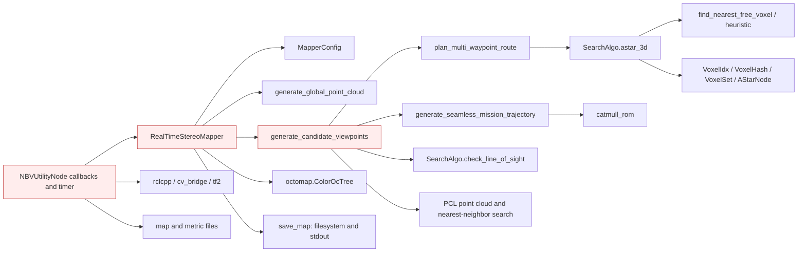
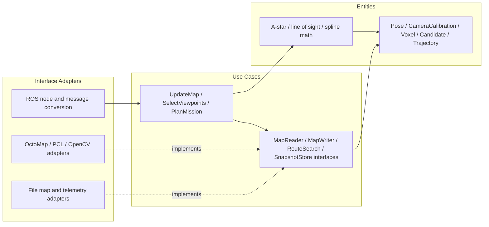
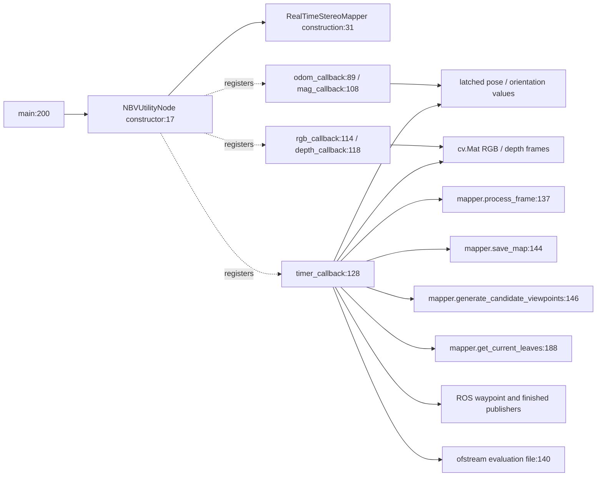
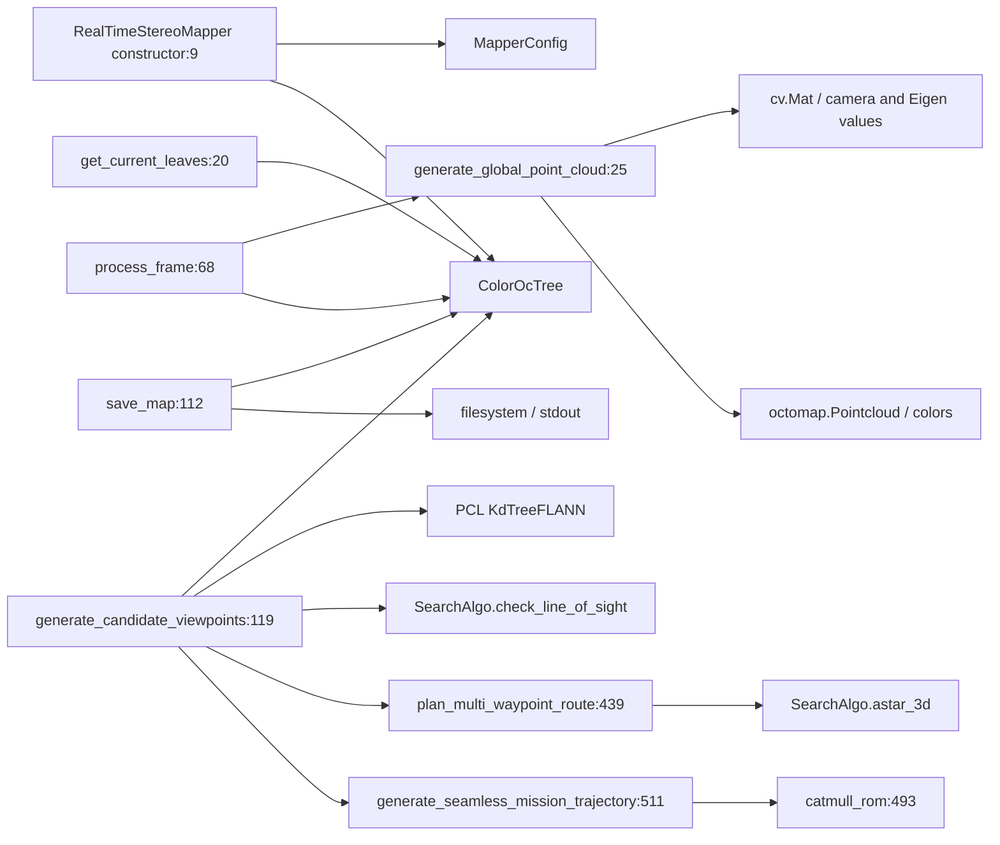
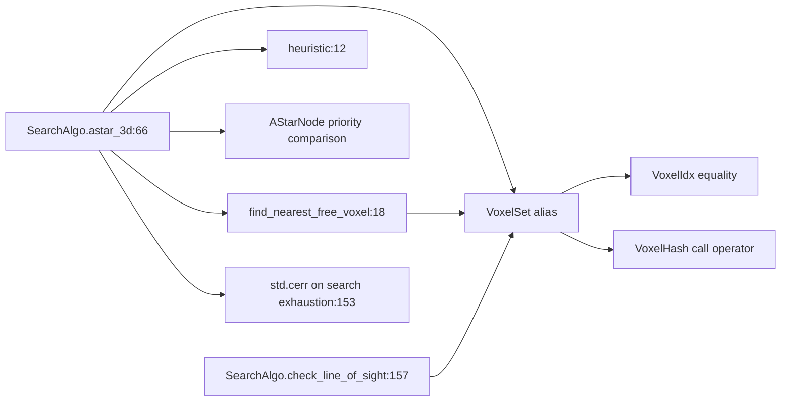

# Package Architecture Audit: active_inspection_planner

## Current Metrics

- Fan-in: 0 | Fan-out: 0
- Instability (I): 0.000*
- Abstractness (A): 0.000 (Na=0; Nc=7)
- Distance (D): 1.000*
- Status: Zone of Pain*

Scope: Separate C++ planner executable; not selected by the current bringup launch. Includes mapping, viewpoint selection, A* and spline generation. Its isolated package metric does not describe its extensive framework coupling.

Counts use the observed source/deployment graph, not ROS topic flow. See [Phase 1 definitions and denominator conventions](../phase_1_topology.md#metric-definitions-and-counting-rules). An asterisk denotes a mathematically undefined denominator replaced by zero only for display; the resulting D/status is conditional. Classification alone is not a violation. All file paths below are relative to `NBV_paper_ros2/src`.

## Violations Found
| ID | Rule Broken | File & Line / Symbol | Concrete Issue | Actor / Architectural Impact |
|---|---|---|---|---|
| V-01 | SRP / DIP | `active_inspection_planner/src/realtime_stereo_mapper.hpp:26` / `RealTimeStereoMapper` | **Critical.** One class owns map insertion and storage, camera projection, frontier selection, route ordering and trajectory smoothing; its public process_frame API takes cv::Mat and private state is a concrete ColorOcTree (lines 30, 51). | Mapping/backend maintainers and mission researchers change the same class; policy cannot be exercised independently of mapping/image libraries. |
| V-02 | DIP | `active_inspection_planner/src/realtime_stereo_mapper.cpp:119` / `generate_candidate_viewpoints` | **Moderate.** Viewpoint policy traverses concrete OctoMap leaves at line 134 and builds PCL search structures; map access has no policy-owned query contract. | A map representation change propagates into utility scoring and candidate planning. |
| V-03 | SRP / DIP | `active_inspection_planner/src/realtime_stereo_mapper.cpp:112` / `save_map` | **Moderate.** The mapping/planning object also writes the on-disk map and reports through stdout; process_frame embeds camera mount calibration at line 73. | Persistence and vehicle-calibration changes share a compilation unit with mission policy. |
| V-04 | SRP / DIP | `active_inspection_planner/src/nbv_utility_node.cpp:15` / `NBVUtilityNode` | **Moderate.** ROS callbacks and timer implement mission progress/termination and map-save behavior while directly constructing RealTimeStereoMapper at line 31. | Mission-policy tests require framework lifecycle or extracted methods; middleware integration and mission research share ownership. |
| V-05 | CCP / CRP | `active_inspection_planner/CMakeLists.txt:21` / `nbv_utility_node target` | **Moderate.** Mapper, route search and ROS entry point are compiled as one executable with no separately reusable policy target. | Search-only reuse inherits the mapping/ROS component release; backend and algorithm changes travel together. |
| V-06 | REP (dependency metadata) | `active_inspection_planner/package.xml:11` / `dependency declarations` | **Moderate.** Manifest omits directly used rclcpp, sensor_msgs, std_msgs, nav_msgs, Eigen and PCL dependencies; compare CMakeLists.txt:14 and nbv_utility_node.cpp:1. | Build/release consumers cannot reconstruct the component dependency closure from its manifest. This is release-contract evidence, not a claim about historical versioning. |

## Proposed Structural Boundary
- Interfaces to extract: `MapReader`, `MapWriter`, `MapSnapshotStore`, `CandidateSelector`, `RouteSearch`, `TrajectoryOutput`, `MissionTelemetry`; each role has a narrow pure virtual boundary using value types.
- Dependencies to invert or decouple: Move OctoMap/PCL/OpenCV behind mapping adapters. Let mission use cases consume map snapshots and injected route search. Keep ROS startup in the composition root and file serialization in an output adapter.

## Current Internal Package Diagram

Solid arrows are calls, construction, field ownership or source dependencies as labeled. These diagrams summarize source relationships, not measured runtime execution; dormant paths are labeled. Red nodes mix policy with details.

## Ideal Clean Internal Package Diagram

This is a proposed partition, not an implemented structure. Ports are policy-owned abstract interfaces (Python Protocol/ABC, C++ pure virtual classes); implementations depend on them. Entities cross ports as plain values. A grouped port box means separate role-specific interfaces, never one mandatory aggregate interface.

## Principle Assessment and Non-Findings

SRP/DIP/CCP/CRP failures are localized below. There is no local inheritance hierarchy establishing an LSP failure, and no demonstrated client forced to implement unused abstract methods (ISP). No local package ADP/SDP edge exists. A=0 is descriptive; the imputed isolated D is not a SAP finding. SearchAlgo and value structs are useful existing separation; numerical Eigen use alone is not treated as an IO leak. No switch-based extension violation is proven merely by choosing A*.

Actor labels are inferred responsibilities, not verified organizational roles. SOLID findings require responsibility, client or contract evidence; line count, inheritance, ordinary guards, framework adapters and missing abstract classes alone do not prove a violation. REP findings establish incomplete reuse/deployment contracts; no release-history audit was performed.

## Module-by-Module Target Placement

| File | Current defined classes / top-level functions | Ideal placement / diagnostic disposition |
|---|---|---|
| `active_inspection_planner/CMakeLists.txt` | No classes/top-level Python functions | Release/build metadata; reconcile dependencies with source. No domain policy extraction. |
| `active_inspection_planner/package.xml` | No classes/top-level Python functions | Release/build metadata; reconcile dependencies with source. No domain policy extraction. |
| `active_inspection_planner/src/nbv_utility_node.cpp` | `NBVUtilityNode:15` | ROS entry adapter plus extracted mission lifecycle use case. |
| `active_inspection_planner/src/realtime_stereo_mapper.cpp` | No classes/top-level Python functions | Split projection/map adapter, candidate/route use cases, spline math and persistence. |
| `active_inspection_planner/src/realtime_stereo_mapper.hpp` | `MapperConfig:13`; `RealTimeStereoMapper:26` | Separate value configuration, narrow map/query contracts, and concrete backend header. |
| `active_inspection_planner/src/search_algo.cpp` | `AStarNode:5` | A-star and visibility entity/use-case math; keep IO/debug outside core. |
| `active_inspection_planner/src/search_algo.hpp` | `VoxelIdx:12`; `VoxelHash:17`; `SearchAlgo:25` | Value structs plus search operation contract; keep IO-free. |

## Class Counting Evidence

- `active_inspection_planner/src/nbv_utility_node.cpp`: `NBVUtilityNode` (line 15).
- `active_inspection_planner/src/realtime_stereo_mapper.hpp`: `MapperConfig` (line 13), `RealTimeStereoMapper` (line 26).
- `active_inspection_planner/src/search_algo.cpp`: `AStarNode` (line 5).
- `active_inspection_planner/src/search_algo.hpp`: `VoxelIdx` (line 12), `VoxelHash` (line 17), `SearchAlgo` (line 25).

## Function and Class Interaction Detail

The following module diagrams are static Python AST call/name and class-containment maps. Dotted edges indicate containment, solid edges an explicit local call. Repeated method names are resolved within the containing class; nested functions belong to their lexical owner. Dynamic dispatch, callbacks registered for later execution and arbitrary imported calls are not inferred as exact call edges. Package diagrams above supply the cross-module and C++ relationships. See [source coverage](../source_coverage.md) for all imports, C++ includes and function symbols.

## C++ Module Interaction Detail

### `src/nbv_utility_node.cpp`

Current: callbacks update latched pose/images; the timer owns mission progression and calls the concrete mapper. Ideal: callbacks become an interface adapter around UpdateMap/PlanMission use cases, with explicit snapshot and telemetry ports.

### `src/realtime_stereo_mapper.hpp` and `src/realtime_stereo_mapper.cpp`

Current: header exposes image/backend-related compilation dependencies; implementation combines mapping, candidate selection, routing, interpolation and save. Ideal: MapperConfig becomes a value contract; projection/backend and file code become adapters; candidate/route orchestration becomes use cases; spline math remains independent.

### `src/search_algo.hpp` and `src/search_algo.cpp`

Current: value/hash structures and static search operations already form a mostly independent algorithm unit. Ideal: retain these in entity/use-case math, expose occupancy values or a narrow reader where needed, and route debug diagnostics through an injected sink. A* and line-of-sight are separate operations; A* does not call line-of-sight.

