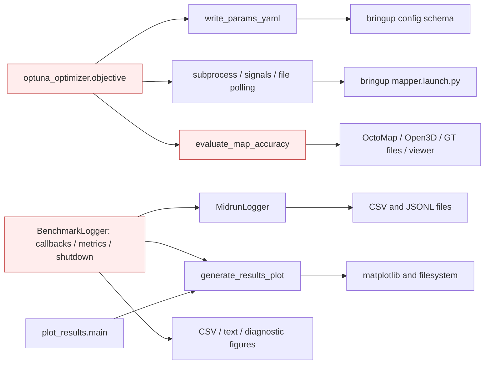
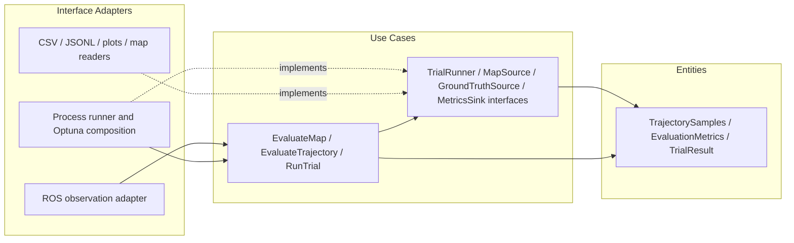
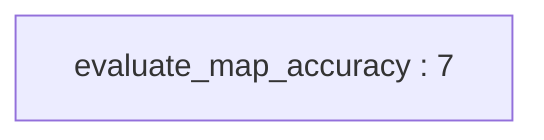
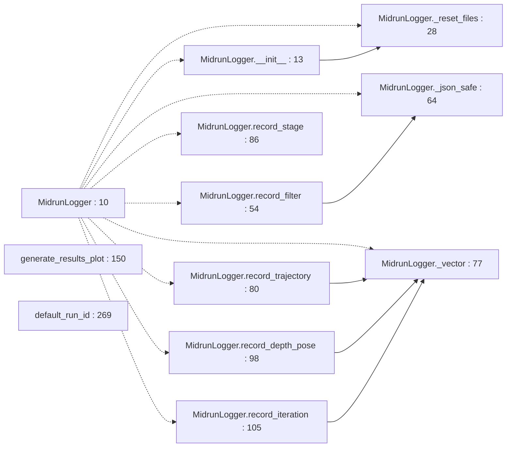
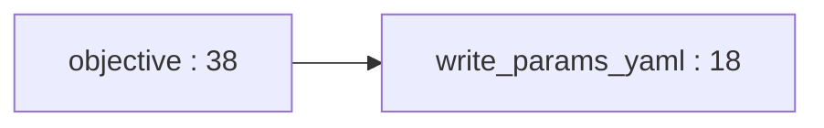
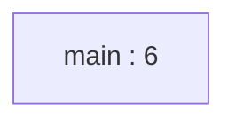
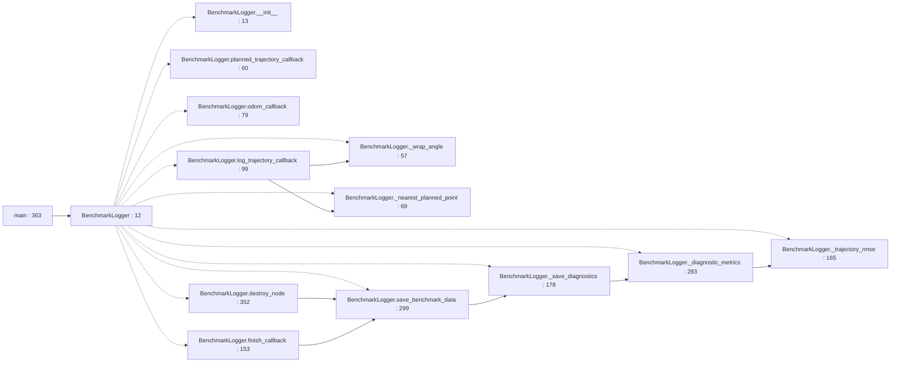

# Package Architecture Audit: benchmark_evaluator

## Current Metrics

- Fan-in: 3 | Fan-out: 1
- Instability (I): 0.250
- Abstractness (A): 0.000 (Na=0; Nc=2)
- Distance (D): 0.750
- Status: Zone of Pain

Scope: A runtime logging library and ROS observer share one release unit with plotting, map scoring and a process-level Optuna experiment driver. Its three incoming component clients make this the primary coupling hotspot.

Counts use the observed source/deployment graph, not ROS topic flow. See [Phase 1 definitions and denominator conventions](../phase_1_topology.md#metric-definitions-and-counting-rules). An asterisk denotes a mathematically undefined denominator replaced by zero only for display; the resulting D/status is conditional. Classification alone is not a violation. All file paths below are relative to `NBV_paper_ros2/src`.

## Violations Found
| ID | Rule Broken | File & Line / Symbol | Concrete Issue | Actor / Architectural Impact |
|---|---|---|---|---|
| V-01 | ADP / SDP | `benchmark_evaluator/benchmark_evaluator/optuna_optimizer.py:63` / `objective launch command` | **Critical.** The experiment driver names bringup, which launches benchmark_evaluator, perception and python_planner; the latter two import this package. This closes three deployment cycles. I rises from 0.250 to 0.833 on benchmark_evaluator → bringup. | Experiment launcher and production runtime cannot be independently organized/released without carrying the cyclic deployment contract. |
| V-02 | CCP / CRP / SAP | `benchmark_evaluator/benchmark_evaluator/midrun_logger.py:10` / `MidrunLogger release placement` | **Critical.** Planner and perception import one concrete logger from a component also containing ROS benchmarking, visualization, OctoMap scoring and Optuna. No abstract telemetry contract protects these stable incoming dependencies (A=0, D=0.750). | Production telemetry consumers depend on an experiment/reporting release they do not otherwise reuse. |
| V-03 | ISP | `benchmark_evaluator/benchmark_evaluator/midrun_logger.py:13` / `MidrunLogger mode flags` | **Moderate.** pipeline_only and trajectory_only select subsets of a single logger API and file initialization, but all clients depend on the full filter/depth/iteration/trajectory implementation. | Perception needs stage timing while planning and evaluation need different event sets; unrelated event-schema changes enlarge each consumer dependency. |
| V-04 | SRP / DIP | `benchmark_evaluator/benchmark_evaluator/run_baselines.py:12` / `BenchmarkLogger` | **Moderate.** The ROS node computes distance, timing, heading and trajectory error, persists CSV/text, generates figures and performs saving during destroy_node (lines 178, 283, 299, 352). | Evaluation researchers, report designers and ROS lifecycle maintainers change one class; IO is embedded in metric use cases. |
| V-05 | SRP / DIP / OCP | `benchmark_evaluator/benchmark_evaluator/benchmark_evaluator.py:7` / `evaluate_map_accuracy` | **Moderate.** Scoring loads fixed map/GT paths, applies scene-specific transforms, performs alignment and presents output. single_station at line 9 and branches at lines 13 and 20 hardcode scenario variants. | Adding an experiment scene or changing storage/viewing requires editing the scoring routine; metrics cannot be invoked on supplied point sets alone. |
| V-06 | SRP / DIP | `benchmark_evaluator/benchmark_evaluator/optuna_optimizer.py:38` / `objective` | **Moderate.** Trial policy samples parameters, rewrites ROS config, deletes prior result artifacts, constructs a shell command, manages a process group and parses mission results. | Research objective changes and deployment/process changes share one function; TrialRunner and structured TrialResult boundaries are absent. |
| V-07 | CCP / REP (contract ownership) | `benchmark_evaluator/benchmark_evaluator/run_baselines.py:307` / `optuna_mission_stats.txt` | **Moderate.** Run completion and optimizer results are coupled through a concrete filename and presentation text (optimizer lines 15, 80, 105). The producer also emits human-oriented report wording. | Changing report wording or file protocol requires coordinated changes in trial execution; an explicit versioned result schema is missing. |
| V-08 | REP (dependency metadata) | `benchmark_evaluator/package.xml:10` / `dependency declarations` | **Moderate.** Manifest declares matplotlib but omits ROS, NumPy, Open3D, pyoctomap, Optuna, YAML and pandas dependencies used by shipped modules; setup.py only declares setuptools and matplotlib. | Consumers of this reuse unit receive incomplete installation requirements; infer neither a release history nor a licensing conclusion from placeholders. |

## Proposed Structural Boundary
- Interfaces to extract: `PipelineTimingSink`, `FilterEventSink`, `TrajectorySink`, `IterationSink`, `TrialRunner`, `EvaluationMapSource`, `GroundTruthSource`, `MetricsSink`, `Clock`.
- Dependencies to invert or decouple: Let planner/perception own telemetry ports; move concrete file writers into an adapter component. Extract evaluation functions over plain observations. Move Optuna plus launch/config knowledge to an outer experiment composition root.

## Current Internal Package Diagram

Solid arrows are calls, construction, field ownership or source dependencies as labeled. These diagrams summarize source relationships, not measured runtime execution; dormant paths are labeled. Red nodes mix policy with details.

## Ideal Clean Internal Package Diagram

This is a proposed partition, not an implemented structure. Ports are policy-owned abstract interfaces (Python Protocol/ABC, C++ pure virtual classes); implementations depend on them. Entities cross ports as plain values. A grouped port box means separate role-specific interfaces, never one mandatory aggregate interface.

## Principle Assessment and Non-Findings

ADP/SDP refer to the observed deployment graph, not cyclic imports. SAP is supported by concrete MidrunLogger being depended upon by unrelated production clients. ISP applies to those clients depending on its aggregate API, not a claim that subclasses are forced to override methods. REP/CCP/CRP evidence is current dependency/reuse structure; team change history was not available. BenchmarkLogger.destroy_node calls its superclass; IO errors could interrupt cleanup, but a proven base-contract violation has not been established, so no LSP finding is asserted.

Actor labels are inferred responsibilities, not verified organizational roles. SOLID findings require responsibility, client or contract evidence; line count, inheritance, ordinary guards, framework adapters and missing abstract classes alone do not prove a violation. REP findings establish incomplete reuse/deployment contracts; no release-history audit was performed.

## Module-by-Module Target Placement

| File | Current defined classes / top-level functions | Ideal placement / diagnostic disposition |
|---|---|---|
| `benchmark_evaluator/benchmark_evaluator/__init__.py` | No classes/top-level Python functions | Empty package marker; no executable policy or class interaction to partition. |
| `benchmark_evaluator/benchmark_evaluator/benchmark_evaluator.py` | `evaluate_map_accuracy:7` | Evaluation use case and pure metrics; map/GT loaders and viewer become adapters. |
| `benchmark_evaluator/benchmark_evaluator/midrun_logger.py` | `MidrunLogger:10`; `generate_results_plot:150`; `default_run_id:269` | Concrete role-specific file sinks and a separate plot adapter; client-owned abstract event contracts. |
| `benchmark_evaluator/benchmark_evaluator/optuna_optimizer.py` | `write_params_yaml:18`; `objective:38` | Outer experiment composition plus RunTrial use case using TrialRunner/ResultStore ports. |
| `benchmark_evaluator/benchmark_evaluator/plot_results.py` | `main:6` | CLI composition adapter; delegating to plot output is appropriate. |
| `benchmark_evaluator/benchmark_evaluator/run_baselines.py` | `BenchmarkLogger:12`; `main:363` | ROS observation adapter, trajectory metric use case and report adapters. |
| `benchmark_evaluator/package.xml` | No classes/top-level Python functions | Release/build metadata; reconcile dependencies with source. No domain policy extraction. |
| `benchmark_evaluator/setup.cfg` | No classes/top-level Python functions | Release/build metadata; reconcile dependencies with source. No domain policy extraction. |
| `benchmark_evaluator/setup.py` | No classes/top-level Python functions | Release/build metadata; reconcile dependencies with source. No domain policy extraction. |
| `benchmark_evaluator/test/test_copyright.py` | `test_copyright:23` | Test-only consumer; excluded from production metrics. Static review only; no test execution claimed. |
| `benchmark_evaluator/test/test_flake8.py` | `test_flake8:21` | Test-only consumer; excluded from production metrics. Static review only; no test execution claimed. |
| `benchmark_evaluator/test/test_pep257.py` | `test_pep257:21` | Test-only consumer; excluded from production metrics. Static review only; no test execution claimed. |

## Class Counting Evidence

- `benchmark_evaluator/benchmark_evaluator/midrun_logger.py`: `MidrunLogger` (line 10).
- `benchmark_evaluator/benchmark_evaluator/run_baselines.py`: `BenchmarkLogger` (line 12).

## Function and Class Interaction Detail

The following module diagrams are static Python AST call/name and class-containment maps. Dotted edges indicate containment, solid edges an explicit local call. Repeated method names are resolved within the containing class; nested functions belong to their lexical owner. Dynamic dispatch, callbacks registered for later execution and arbitrary imported calls are not inferred as exact call edges. Package diagrams above supply the cross-module and C++ relationships. See [source coverage](../source_coverage.md) for all imports, C++ includes and function symbols.

### `benchmark_evaluator/__init__.py`

Ideal placement: Empty package marker; no executable policy or class interaction to partition.

No executable local symbol interaction (empty marker or import/registry facade).

### `benchmark_evaluator/benchmark_evaluator.py`

Ideal placement: Evaluation use case and pure metrics; map/GT loaders and viewer become adapters.

### `benchmark_evaluator/midrun_logger.py`

Ideal placement: Concrete role-specific file sinks and a separate plot adapter; client-owned abstract event contracts.

### `benchmark_evaluator/optuna_optimizer.py`

Ideal placement: Outer experiment composition plus RunTrial use case using TrialRunner/ResultStore ports.

### `benchmark_evaluator/plot_results.py`

Ideal placement: CLI composition adapter; delegating to plot output is appropriate.

### `benchmark_evaluator/run_baselines.py`

Ideal placement: ROS observation adapter, trajectory metric use case and report adapters.

