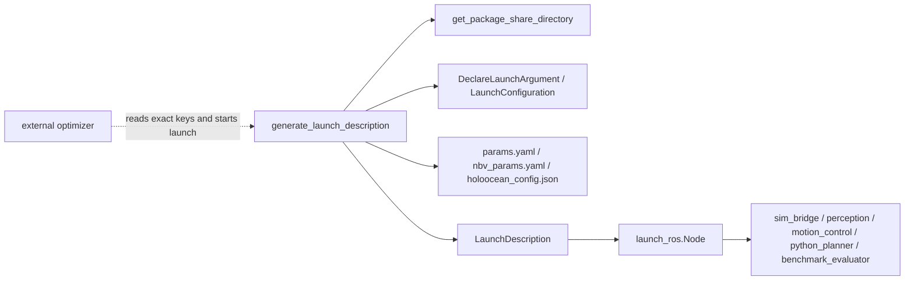
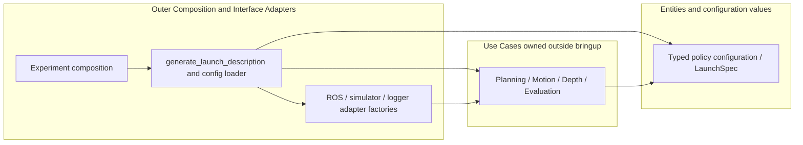
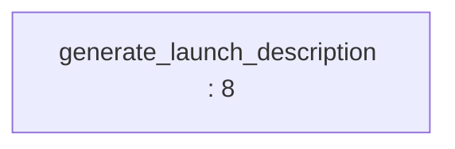

# Package Architecture Audit: bringup

## Current Metrics

- Fan-in: 1 | Fan-out: 5
- Instability (I): 0.833
- Abstractness (A): 0.000* (Na=0; Nc=0)
- Distance (D): 0.167*
- Status: Zone of Pain*

Scope: Composition-only Python ROS package: launch wiring and configuration resources, no production classes. Concrete framework references are appropriate at this outer boundary.

Counts use the observed source/deployment graph, not ROS topic flow. See [Phase 1 definitions and denominator conventions](../phase_1_topology.md#metric-definitions-and-counting-rules). An asterisk denotes a mathematically undefined denominator replaced by zero only for display; the resulting D/status is conditional. Classification alone is not a violation. All file paths below are relative to `NBV_paper_ros2/src`.

## Violations Found
| ID | Rule Broken | File & Line / Symbol | Concrete Issue | Actor / Architectural Impact |
|---|---|---|---|---|
| V-01 | ADP | `bringup/launch/mapper.launch.py:77` / `benchmark observer launch` | **Critical.** Launch depends on benchmark_evaluator while its optimizer launches this same bringup component; perception/planner launch paths also close the longer telemetry cycles. | Production composition is cyclically coupled to experiment orchestration. Launching an observer is legitimate; placing the reverse launcher in that observer release causes the cycle. |
| V-02 | REP (dependency metadata) | `bringup/package.xml:11` / `dependency declarations` | **Moderate.** Manifest has test dependencies but none for launch, launch_ros, ament_index_python or the five launched scoped components. | A consumer installing bringup cannot rely on the declared closure to obtain the executables it orchestrates. |
| V-03 | CCP | `bringup/launch/mapper.launch.py:11` / `configuration resource contract` | **Moderate.** The launch package owns ROS configuration files whose exact node keys and source-tree layout are read and rewritten by benchmark_evaluator/optuna_optimizer.py:12 and :23. | Deployment renames and research parameter injection require coordinated edits across two components; configuration translation needs one owner. |

## Proposed Structural Boundary
- Interfaces to extract: No abstract wrapper around LaunchDescription is needed. Extract a plain LaunchSpec/ExperimentConfig contract for the external experiment runner; keep policy-owned parameter objects in their policy components.
- Dependencies to invert or decouple: Keep deployment composition depending on adapters and use-case factories. Move optimizer-specific invocation and interpretation into the experiment root; declare all launched packages and launch tools.

## Current Internal Package Diagram

Solid arrows are calls, construction, field ownership or source dependencies as labeled. These diagrams summarize source relationships, not measured runtime execution; dormant paths are labeled. Red nodes mix policy with details.

## Ideal Clean Internal Package Diagram

This is a proposed partition, not an implemented structure. Ports are policy-owned abstract interfaces (Python Protocol/ABC, C++ pure virtual classes); implementations depend on them. Entities cross ports as plain values. A grouped port box means separate role-specific interfaces, never one mandatory aggregate interface.

## Principle Assessment and Non-Findings

SRP: composition is an appropriate single responsibility; multiple Node constructions do not prove an SRP/OCP failure. No subtypes or interfaces exist to support LSP/ISP findings. The A denominator is zero, so SAP is not inferred from an imputed D. The cycle requires external optimizer behavior and is described as a deployment cycle. Configuration clustering is an ownership risk, not proof that each YAML key belongs in a separate release.

Actor labels are inferred responsibilities, not verified organizational roles. SOLID findings require responsibility, client or contract evidence; line count, inheritance, ordinary guards, framework adapters and missing abstract classes alone do not prove a violation. REP findings establish incomplete reuse/deployment contracts; no release-history audit was performed.

## Module-by-Module Target Placement

| File | Current defined classes / top-level functions | Ideal placement / diagnostic disposition |
|---|---|---|
| `bringup/bringup/__init__.py` | No classes/top-level Python functions | Empty package marker; no executable policy or class interaction to partition. |
| `bringup/config/holoocean_config copy.json` | No classes/top-level Python functions | Configuration data at composition boundary; version/validate schema and translate to policy values. |
| `bringup/config/holoocean_config.json` | No classes/top-level Python functions | Configuration data at composition boundary; version/validate schema and translate to policy values. |
| `bringup/config/nbv_params.yaml` | No classes/top-level Python functions | Configuration data at composition boundary; version/validate schema and translate to policy values. |
| `bringup/config/params.yaml` | No classes/top-level Python functions | Configuration data at composition boundary; version/validate schema and translate to policy values. |
| `bringup/launch/mapper.launch.py` | `generate_launch_description:8` | Outer composition root; keep framework dependencies here. |
| `bringup/package.xml` | No classes/top-level Python functions | Release/build metadata; reconcile dependencies with source. No domain policy extraction. |
| `bringup/setup.cfg` | No classes/top-level Python functions | Release/build metadata; reconcile dependencies with source. No domain policy extraction. |
| `bringup/setup.py` | No classes/top-level Python functions | Release/build metadata; reconcile dependencies with source. No domain policy extraction. |
| `bringup/test/test_copyright.py` | `test_copyright:23` | Test-only consumer; excluded from production metrics. Static review only; no test execution claimed. |
| `bringup/test/test_flake8.py` | `test_flake8:21` | Test-only consumer; excluded from production metrics. Static review only; no test execution claimed. |
| `bringup/test/test_pep257.py` | `test_pep257:21` | Test-only consumer; excluded from production metrics. Static review only; no test execution claimed. |

## Class Counting Evidence

No locally defined production classes. A=0/0 is undefined.

## Function and Class Interaction Detail

The following module diagrams are static Python AST call/name and class-containment maps. Dotted edges indicate containment, solid edges an explicit local call. Repeated method names are resolved within the containing class; nested functions belong to their lexical owner. Dynamic dispatch, callbacks registered for later execution and arbitrary imported calls are not inferred as exact call edges. Package diagrams above supply the cross-module and C++ relationships. See [source coverage](../source_coverage.md) for all imports, C++ includes and function symbols.

### `bringup/__init__.py`

Ideal placement: Empty package marker; no executable policy or class interaction to partition.

No executable local symbol interaction (empty marker or import/registry facade).

### `launch/mapper.launch.py`

Ideal placement: Outer composition root; keep framework dependencies here.

