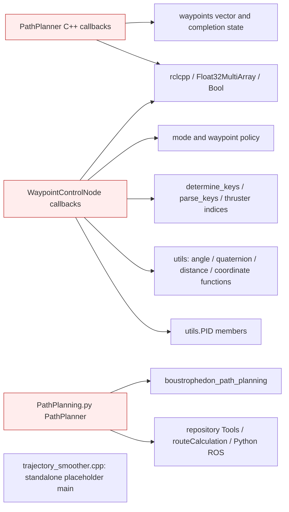
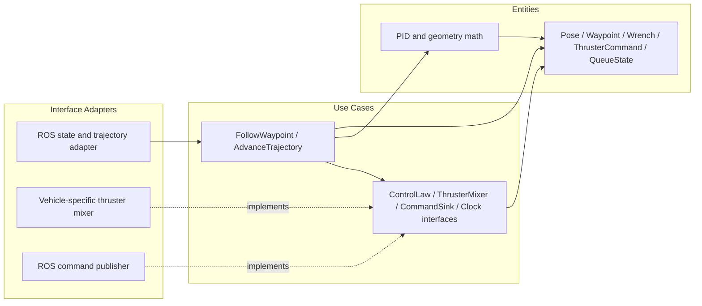
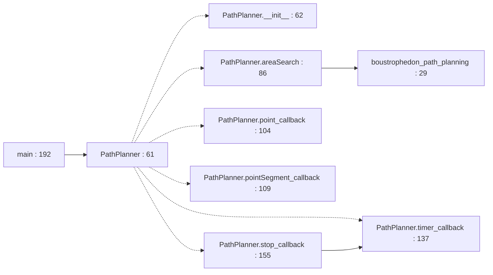
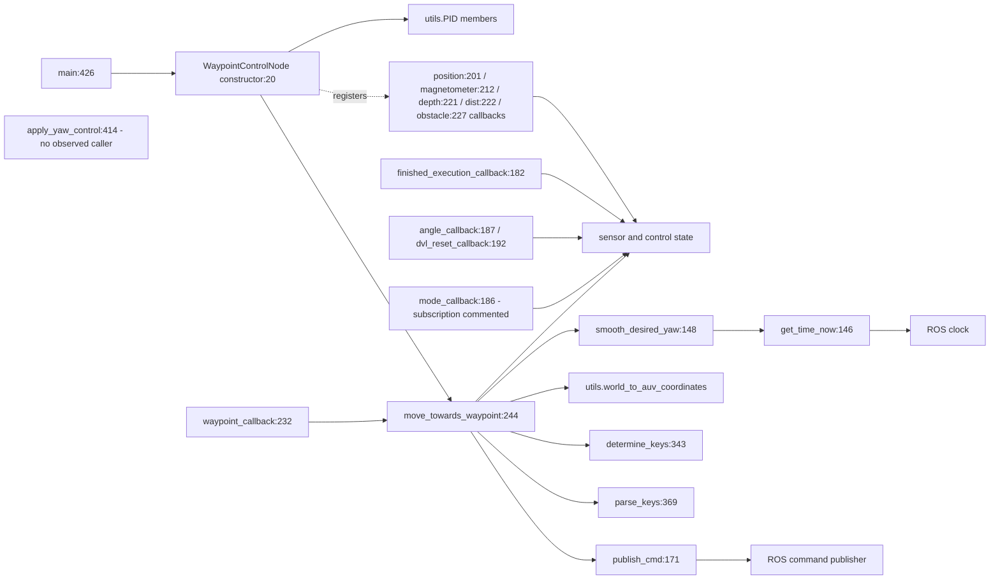
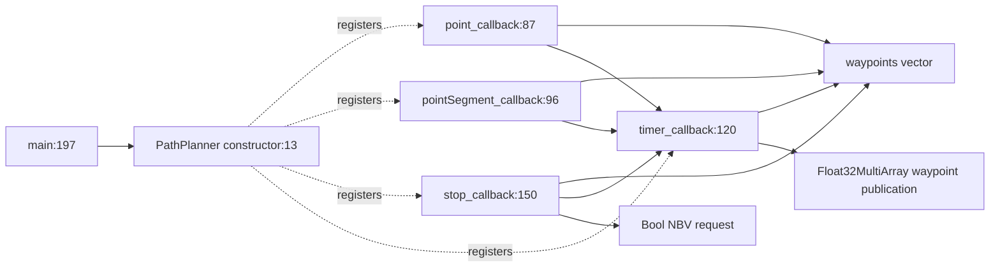
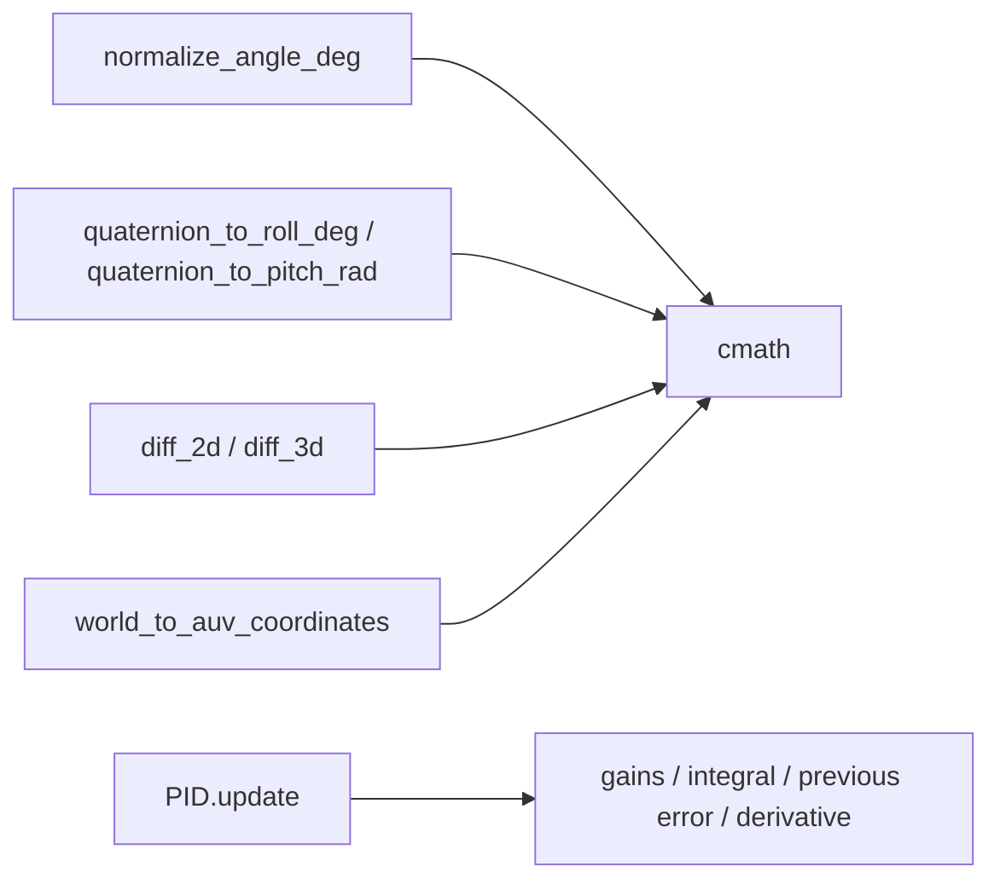
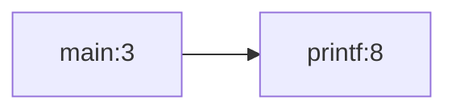

# Package Architecture Audit: auv_motion_control

## Current Metrics

- Fan-in: 1 | Fan-out: 0
- Instability (I): 0.000
- Abstractness (A): 0.000 (Na=0; Nc=4)
- Distance (D): 1.000
- Status: Zone of Pain

Scope: Two compiled ROS executables plus a math/PID header, an unbuilt legacy Python planner and a trajectory_smoother placeholder. Do not equate the legacy files with the active control path.

Counts use the observed source/deployment graph, not ROS topic flow. See [Phase 1 definitions and denominator conventions](../phase_1_topology.md#metric-definitions-and-counting-rules). An asterisk denotes a mathematically undefined denominator replaced by zero only for display; the resulting D/status is conditional. Classification alone is not a violation. All file paths below are relative to `NBV_paper_ros2/src`.

## Violations Found
| ID | Rule Broken | File & Line / Symbol | Concrete Issue | Actor / Architectural Impact |
|---|---|---|---|---|
| V-01 | SRP / DIP | `auv_motion_control/src/waypoint_control_node.cpp:17` / `WaypointControlNode` | **Critical.** One ROS node owns sensor state, heading/waypoint policy, runtime parameter access, vehicle-specific eight-thruster mixing and command publication (lines 279, 323, 340, 369). | Guidance, vehicle hardware allocation and middleware actors share one class; controller tests cannot substitute output/mixing without reaching into node internals. |
| V-02 | OCP | `auv_motion_control/src/waypoint_control_node.cpp:293` / `mode branches / parse_keys` | **Moderate.** Modes yaw_centerize/full_centerize and key-to-thruster branches at line 369 are hardcoded into the policy class. | Adding a control mode or vehicle layout requires modifying the shared controller; use a selected ControlLaw and platform mixer at the composition boundary. |
| V-03 | SRP / DIP | `auv_motion_control/src/point_iterator.cpp:10` / `PathPlanner` | **Moderate.** Queue progression, initial mission state and waypoint completion are hosted directly inside a ROS Node with transport arrays and timers. | Mission queue behavior and transport changes share one object; a pure queue state machine cannot currently be called independently. |
| V-04 | CCP / DIP | `auv_motion_control/src/point_iterator.cpp:53` / `pointSegment_callback wire format` | **Moderate.** Trajectory input uses Float32MultiArray and an implicit four-value waypoint convention, mirrored in auv_planner_reference/planner_node.py:_publish_trajectory and controller input. | Trajectory schema changes require coordinated planner/control edits without a shared domain value contract; this is protocol coupling, not an additional source import edge. |
| V-05 | CRP / DIP | `auv_motion_control/src/PathPlanning.py:11` / `legacy PathPlanner imports` | **Low.** Unbuilt legacy Python source mutates sys.path to an absolute repository path and imports Tools.explore2D, Tools.mapping2D and routeCalculation outside this component. | Reusing the dormant planner requires repository layout and unrelated helper dependencies; separate or retire it only in a later authorized migration. |
| V-06 | REP (dependency metadata) | `auv_motion_control/package.xml:10` / `dependency declarations` | **Moderate.** Manifest contains no dependencies for rclcpp and ROS messages used in the compiled nodes; CMake additionally finds and links nlohmann_json. | Build/release metadata does not describe the component actually installed. The unbuilt placeholder alone is not a SOLID violation. |

## Proposed Structural Boundary
- Interfaces to extract: `VehicleState`, `WaypointQueue`, `ControlLaw`, `ThrusterMixer`, `CommandSink`, `Clock`; split guidance decisions from platform allocation and ROS serialization.
- Dependencies to invert or decouple: Move control and queue use cases out of Node subclasses; adapters translate ROS arrays to typed trajectory/report values. Inject a vehicle-specific mixer. Preserve current control behavior during any later extraction.

## Current Internal Package Diagram

Solid arrows are calls, construction, field ownership or source dependencies as labeled. These diagrams summarize source relationships, not measured runtime execution; dormant paths are labeled. Red nodes mix policy with details.

## Ideal Clean Internal Package Diagram

This is a proposed partition, not an implemented structure. Ports are policy-owned abstract interfaces (Python Protocol/ABC, C++ pure virtual classes); implementations depend on them. Entities cross ports as plain values. A grouped port box means separate role-specific interfaces, never one mandatory aggregate interface.

## Principle Assessment and Non-Findings

Observed Node inheritance is framework integration, not itself an LSP violation; no replacement contract failure is demonstrated. No abstract fat interface is present to prove ISP. Package graph has no outgoing scoped edge and no ADP/SDP violation; I=0 is a closed-graph artifact. Concrete control policy embedded in a ROS adapter is a DIP issue independently of that metric. PID and geometry are already framework-free; do not create interfaces for every arithmetic helper.

Actor labels are inferred responsibilities, not verified organizational roles. SOLID findings require responsibility, client or contract evidence; line count, inheritance, ordinary guards, framework adapters and missing abstract classes alone do not prove a violation. REP findings establish incomplete reuse/deployment contracts; no release-history audit was performed.

## Module-by-Module Target Placement

| File | Current defined classes / top-level functions | Ideal placement / diagnostic disposition |
|---|---|---|
| `auv_motion_control/CMakeLists.txt` | No classes/top-level Python functions | Release/build metadata; reconcile dependencies with source. No domain policy extraction. |
| `auv_motion_control/package.xml` | No classes/top-level Python functions | Release/build metadata; reconcile dependencies with source. No domain policy extraction. |
| `auv_motion_control/src/PathPlanning.py` | `PathPlanner:61`; `boustrophedon_path_planning:29`; `main:192` | Legacy ROS entry adapter plus coverage/queue use cases; resolve explicit module ownership. |
| `auv_motion_control/src/math_pid_utils.hpp` | `PID:45` | Framework-free entity/control math; preserve useful separation. |
| `auv_motion_control/src/point_iterator.cpp` | `PathPlanner:10` | ROS adapter around a pure trajectory queue/state use case. |
| `auv_motion_control/src/trajectory_smoother.cpp` | No classes/top-level Python functions | Unbuilt placeholder: no substantive architecture to partition; no violation solely for placeholder status. |
| `auv_motion_control/src/waypoint_control_node.cpp` | `WaypointControlNode:17` | Split guidance use case, ROS adapter and platform thruster mixer. |

## Class Counting Evidence

- `auv_motion_control/src/PathPlanning.py`: `PathPlanner` (line 61).
- `auv_motion_control/src/math_pid_utils.hpp`: `PID` (line 45).
- `auv_motion_control/src/point_iterator.cpp`: `PathPlanner` (line 10).
- `auv_motion_control/src/waypoint_control_node.cpp`: `WaypointControlNode` (line 17).

## Function and Class Interaction Detail

The following module diagrams are static Python AST call/name and class-containment maps. Dotted edges indicate containment, solid edges an explicit local call. Repeated method names are resolved within the containing class; nested functions belong to their lexical owner. Dynamic dispatch, callbacks registered for later execution and arbitrary imported calls are not inferred as exact call edges. Package diagrams above supply the cross-module and C++ relationships. See [source coverage](../source_coverage.md) for all imports, C++ includes and function symbols.

### `src/PathPlanning.py`

Ideal placement: Legacy ROS entry adapter plus coverage/queue use cases; resolve explicit module ownership.

## C++ Module Interaction Detail

### `src/waypoint_control_node.cpp`

Current: callback state and control policy share a ROS node with vehicle-specific allocation. Ideal: state conversion in interface adapters, FollowWaypoint/ControlLaw in use cases, typed pose/wrench/command entities and a platform mixer behind its own interface. PID objects are constructed members, but no PID.update call is present in this source; the diagram does not imply they drive the active control law.

### `src/point_iterator.cpp`

Current: callbacks decode arrays and mutate a waypoint vector; timer encodes it for ROS; stop callback advances completion state. Ideal: typed queue entity and AdvanceTrajectory use case, with transport parsing/publishing in adapters.

### `src/math_pid_utils.hpp`

Current and ideal: pure numerical functions and PID state, already separate from ROS/IO. They may remain concrete; there is no demonstrated need for an abstract facade per math function.

### `src/trajectory_smoother.cpp`

Current: standalone main calls printf; it is absent from the executable targets in CMakeLists.txt. Ideal: retain as an explicitly classified placeholder or decide its future in a separate migration; no entity/use-case abstraction is warranted for this stub.

