# Package Architecture Audit: perception

## Current Metrics

- Fan-in: 1 | Fan-out: 1
- Instability (I): 0.500
- Abstractness (A): 0.000 (Na=0; Nc=20)
- Distance (D): 0.500
- Status: Zone of Pain

Scope: ROS stereo depth adapter, eager global inference module and vendored BGNet research code (20 concrete classes total). BGNet is a pinned Git submodule with its own upstream provenance, but has no separate package.xml or setup.py release unit here; its Python subpackages are measured inside the enclosing ROS component.

Counts use the observed source/deployment graph, not ROS topic flow. See [Phase 1 definitions and denominator conventions](../phase_1_topology.md#metric-definitions-and-counting-rules). An asterisk denotes a mathematically undefined denominator replaced by zero only for display; the resulting D/status is conditional. Classification alone is not a violation. All file paths below are relative to `NBV_paper_ros2/src`.

## Violations Found
| ID | Rule Broken | File & Line / Symbol | Concrete Issue | Actor / Architectural Impact |
|---|---|---|---|---|
| V-01 | DIP / SRP | `perception/perception/compute_depth.py:15` / `global inference initialization` | **Critical.** Importing compute_stereo_depth constructs BGNet_Plus, chooses the device, loads a concrete checkpoint and configures transforms at module scope (lines 18–24). | Depth computation cannot be imported without model-loading infrastructure; inference research, deployment paths and hardware startup share module lifecycle. |
| V-02 | REP / DIP | `perception/perception/compute_depth.py:7` / `sys.path and checkpoint paths` | **Moderate.** Absolute workstation sys.path and model-file paths resolve top-level models/datasets imports outside the normal installed perception namespace. | Installation/reuse depends on source checkout layout; model packaging and application startup are coupled. |
| V-03 | SRP / DIP | `perception/perception/depth_estimation.py:61` / `sync_cam_callback` | **Moderate.** ROS callback converts images, applies camera-specific inference arguments, invokes the concrete depth function, records file-backed telemetry and publishes output; logger is constructed at line 29. | ROS synchronization, model selection/calibration and experiment logging cannot change independently at a use-case boundary. |
| V-04 | DIP / CRP / ADP | `perception/perception/depth_estimation.py:13` / `MidrunLogger import` | **Moderate.** Perception depends on benchmark_evaluator only to obtain a timing writer, pulling an experiment component into runtime depth processing and closing a deployment cycle through bringup. | Logging/storage changes and experiment component packaging affect the perception release. |
| V-05 | CCP / CRP | `perception/setup.py:8` / `find_packages and BGNet subtree` | **Moderate.** Runtime ROS inference and vendored model variants, dataset classes and research prediction utilities occupy the same package tree/release boundary. | Consumers needing only depth inference inherit changes for dataset/research tooling they do not reuse. Keep framework model internals cohesive behind an adapter. |
| V-06 | OCP | `perception/perception/BGNet/predict.py:36` / `model and dataset selection` | **Low.** Model selection and output-folder selection use literal if/elif branches; adding a model or dataset requires editing the prediction script in addition to model/dataset definitions. | Research variant authors modify the central runner; a registry or injected factory can localize extension. CLI composition is a low-severity boundary, not a demand for polymorphism in every branch. |
| V-07 | REP (dependency metadata) | `perception/package.xml:11` / `dependency declarations` | **Moderate.** Manifest declares benchmark_evaluator and message_filters but omits rclpy, sensor/std messages, cv_bridge, NumPy, OpenCV, Torch, torchvision and PIL used by runtime source; setup.py declares only setuptools. | The release unit does not communicate its runtime installation requirements. |

## Proposed Structural Boundary
- Interfaces to extract: `StereoDepthEstimator`, `DepthOutput`, `PipelineTimingSink`, `ModelLoader`; pass StereoPair, CameraCalibration and DepthFrame values through a client-owned boundary.
- Dependencies to invert or decouple: Construct BGNet/checkpoint/device adapters explicitly at startup. Keep ROS synchronization outside depth policy and reuse only narrow telemetry contracts. Isolate vendored research dataset and prediction utilities from runtime inference packaging.

## Current Internal Package Diagram

Solid arrows are calls, construction, field ownership or source dependencies as labeled. These diagrams summarize source relationships, not measured runtime execution; dormant paths are labeled. Red nodes mix policy with details.

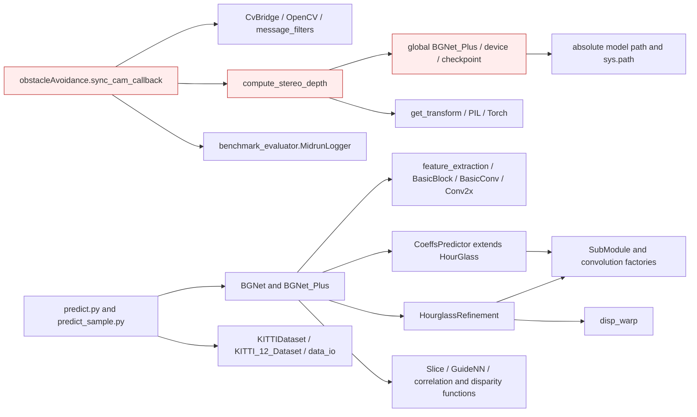

## Ideal Clean Internal Package Diagram

This is a proposed partition, not an implemented structure. Ports are policy-owned abstract interfaces (Python Protocol/ABC, C++ pure virtual classes); implementations depend on them. Entities cross ports as plain values. A grouped port box means separate role-specific interfaces, never one mandatory aggregate interface.

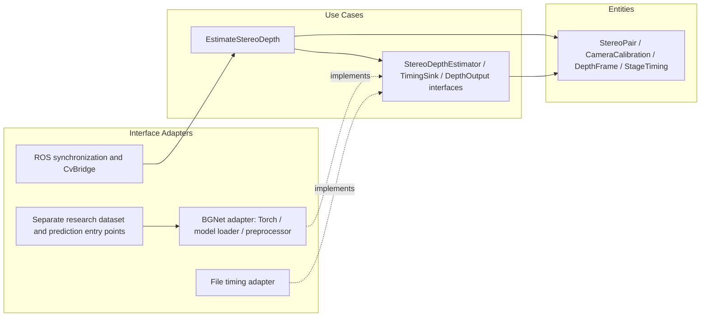

## Principle Assessment and Non-Findings

PyTorch models legitimately depend on Torch as outer inference implementations; those imports are not independently labeled DIP violations. Dataset and Module subclasses show no demonstrated substitution-contract violation. The inconsistent dataset load_path tuple arity and conditionally defined get_last_depth_timings are ordinary contract/correctness concerns, recorded separately rather than mislabeled LSP. No abstract fat interface is implemented here; the concrete logger dependency is assessed under benchmark ISP. ADP membership comes from deployment plus telemetry, not BGNet cyclic imports.

Actor labels are inferred responsibilities, not verified organizational roles. SOLID findings require responsibility, client or contract evidence; line count, inheritance, ordinary guards, framework adapters and missing abstract classes alone do not prove a violation. REP findings establish incomplete reuse/deployment contracts; no release-history audit was performed.

## Module-by-Module Target Placement

| File | Current defined classes / top-level functions | Ideal placement / diagnostic disposition |
|---|---|---|
| `perception/package.xml` | No classes/top-level Python functions | Release/build metadata; reconcile dependencies with source. No domain policy extraction. |
| `perception/perception/BGNet/__init__.py` | No classes/top-level Python functions | Empty package marker; no executable policy or class interaction to partition. |
| `perception/perception/BGNet/dataloader/__init__.py` | No classes/top-level Python functions | Empty package marker; no executable policy or class interaction to partition. |
| `perception/perception/BGNet/datasets/__init__.py` | No classes/top-level Python functions | Vendored dataset/loading adapter. Isolate from production depth-policy release; no need to wrap each transform. |
| `perception/perception/BGNet/datasets/data_io.py` | `mean_std_transform:11`; `get_transform:42`; `read_all_lines:54`; `pfm_imread:61` | Vendored dataset/loading adapter. Isolate from production depth-policy release; no need to wrap each transform. |
| `perception/perception/BGNet/datasets/kitti12_dataset.py` | `KITTI_12_Dataset:15` | Vendored dataset/loading adapter. Isolate from production depth-policy release; no need to wrap each transform. |
| `perception/perception/BGNet/datasets/kitti_dataset.py` | `KITTIDataset:15` | Vendored dataset/loading adapter. Isolate from production depth-policy release; no need to wrap each transform. |
| `perception/perception/BGNet/models/__init__.py` | No classes/top-level Python functions | Vendored Torch inference implementation behind StereoDepthEstimator; concrete internal network composition is appropriate. |
| `perception/perception/BGNet/models/bgnet.py` | `Slice:16`; `GuideNN:26`; `BGNet:67`; `groupwise_correlation:36`; `build_gwc_volume:45`; `correlation:56`; `disparity_regression:62` | Vendored Torch inference implementation behind StereoDepthEstimator; concrete internal network composition is appropriate. |
| `perception/perception/BGNet/models/bgnet_plus.py` | `Slice:16`; `GuideNN:27`; `BGNet_Plus:70`; `groupwise_correlation:37`; `build_gwc_volume:47`; `correlation:59`; `disparity_regression:65` | Vendored Torch inference implementation behind StereoDepthEstimator; concrete internal network composition is appropriate. |
| `perception/perception/BGNet/models/feature_extractor_fast.py` | `BasicBlock:23`; `BasicConv:44`; `Conv2x:72`; `feature_extraction:104`; `convbn_relu:11`; `convbn:17` | Vendored Torch inference implementation behind StereoDepthEstimator; concrete internal network composition is appropriate. |
| `perception/perception/BGNet/models/submodules.py` | `BasicBlock:64`; `SubModule:86`; `convbn_2d_lrelu:9`; `convbn_2d_Tanh:16`; `deconvbn_2d_lrelu:23`; `convbn_3d_lrelu:30`; `conv_relu:38`; `convbn:43`; `convbn_relu:50`; `convbn_transpose_3d:58` | Vendored Torch inference implementation behind StereoDepthEstimator; concrete internal network composition is appropriate. |
| `perception/perception/BGNet/models/submodules2d.py` | `BasicConv:24`; `Conv2x:52`; `HourglassRefinement:87`; `disparity_regression:12`; `conv2d:17` | Vendored Torch inference implementation behind StereoDepthEstimator; concrete internal network composition is appropriate. |
| `perception/perception/BGNet/models/submodules3d.py` | `HourGlass:11`; `CoeffsPredictor:33` | Vendored Torch inference implementation behind StereoDepthEstimator; concrete internal network composition is appropriate. |
| `perception/perception/BGNet/nets/warp.py` | `disp_warp:9` | Vendored Torch inference implementation behind StereoDepthEstimator; concrete internal network composition is appropriate. |
| `perception/perception/BGNet/predict.py` | No classes/top-level Python functions | Research CLI/composition adapter; keep model selection and filesystem outside the reusable depth policy. |
| `perception/perception/BGNet/predict.sh` | No classes/top-level Python functions | Research CLI/composition adapter; keep model selection and filesystem outside the reusable depth policy. |
| `perception/perception/BGNet/predict_sample.py` | No classes/top-level Python functions | Research CLI/composition adapter; keep model selection and filesystem outside the reusable depth policy. |
| `perception/perception/__init__.py` | No classes/top-level Python functions | Empty package marker; no executable policy or class interaction to partition. |
| `perception/perception/compute_depth.py` | `compute_stereo_depth:43` | Depth use case plus constructed BGNet model adapter; remove import-time composition in a later migration. |
| `perception/perception/depth_estimation.py` | `obstacleAvoidance:18`; `main:127` | ROS synchronization/input-output adapter around depth use case. |
| `perception/setup.cfg` | No classes/top-level Python functions | Release/build metadata; reconcile dependencies with source. No domain policy extraction. |
| `perception/setup.py` | No classes/top-level Python functions | Release/build metadata; reconcile dependencies with source. No domain policy extraction. |
| `perception/test/test_copyright.py` | `test_copyright:23` | Test-only consumer; excluded from production metrics. Static review only; no test execution claimed. |
| `perception/test/test_flake8.py` | `test_flake8:21` | Test-only consumer; excluded from production metrics. Static review only; no test execution claimed. |
| `perception/test/test_pep257.py` | `test_pep257:21` | Test-only consumer; excluded from production metrics. Static review only; no test execution claimed. |

## Class Counting Evidence

- `perception/perception/BGNet/datasets/kitti12_dataset.py`: `KITTI_12_Dataset` (line 15).
- `perception/perception/BGNet/datasets/kitti_dataset.py`: `KITTIDataset` (line 15).
- `perception/perception/BGNet/models/bgnet.py`: `Slice` (line 16), `GuideNN` (line 26), `BGNet` (line 67).
- `perception/perception/BGNet/models/bgnet_plus.py`: `Slice` (line 16), `GuideNN` (line 27), `BGNet_Plus` (line 70).
- `perception/perception/BGNet/models/feature_extractor_fast.py`: `BasicBlock` (line 23), `BasicConv` (line 44), `Conv2x` (line 72), `feature_extraction` (line 104).
- `perception/perception/BGNet/models/submodules.py`: `BasicBlock` (line 64), `SubModule` (line 86).
- `perception/perception/BGNet/models/submodules2d.py`: `BasicConv` (line 24), `Conv2x` (line 52), `HourglassRefinement` (line 87).
- `perception/perception/BGNet/models/submodules3d.py`: `HourGlass` (line 11), `CoeffsPredictor` (line 33).
- `perception/perception/depth_estimation.py`: `obstacleAvoidance` (line 18).

## Function and Class Interaction Detail

The following module diagrams are static Python AST call/name and class-containment maps. Dotted edges indicate containment, solid edges an explicit local call. Repeated method names are resolved within the containing class; nested functions belong to their lexical owner. Dynamic dispatch, callbacks registered for later execution and arbitrary imported calls are not inferred as exact call edges. Package diagrams above supply the cross-module and C++ relationships. See [source coverage](../source_coverage.md) for all imports, C++ includes and function symbols.

### `perception/BGNet/__init__.py`

Ideal placement: Empty package marker; no executable policy or class interaction to partition.

No executable local symbol interaction (empty marker or import/registry facade).

### `perception/BGNet/dataloader/__init__.py`

Ideal placement: Empty package marker; no executable policy or class interaction to partition.

No executable local symbol interaction (empty marker or import/registry facade).

### `perception/BGNet/datasets/__init__.py`

Ideal placement: Vendored dataset/loading adapter. Isolate from production depth-policy release; no need to wrap each transform.

No executable local symbol interaction (empty marker or import/registry facade).

### `perception/BGNet/datasets/data_io.py`

Ideal placement: Vendored dataset/loading adapter. Isolate from production depth-policy release; no need to wrap each transform.

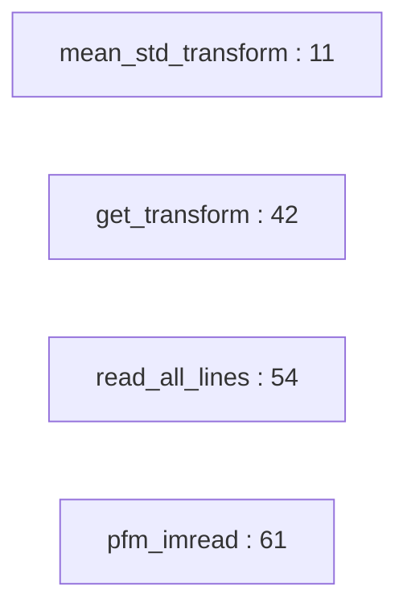

### `perception/BGNet/datasets/kitti12_dataset.py`

Ideal placement: Vendored dataset/loading adapter. Isolate from production depth-policy release; no need to wrap each transform.

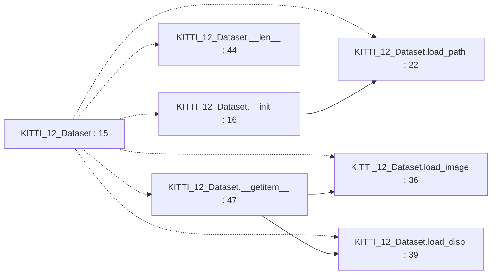

### `perception/BGNet/datasets/kitti_dataset.py`

Ideal placement: Vendored dataset/loading adapter. Isolate from production depth-policy release; no need to wrap each transform.

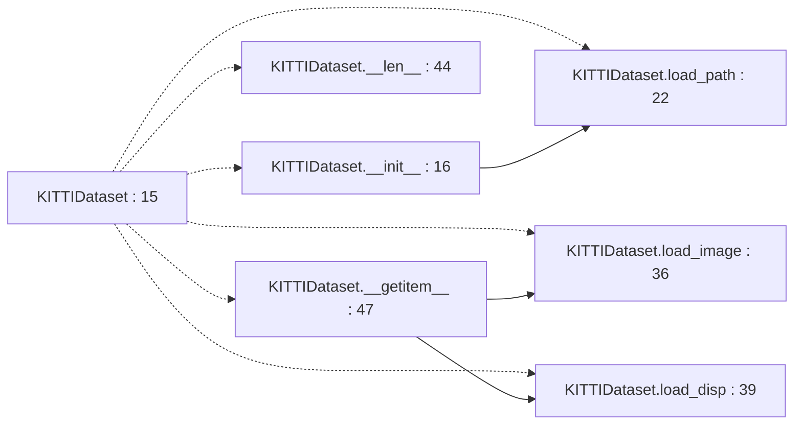

### `perception/BGNet/models/__init__.py`

Ideal placement: Vendored Torch inference implementation behind StereoDepthEstimator; concrete internal network composition is appropriate.

No executable local symbol interaction (empty marker or import/registry facade).

### `perception/BGNet/models/bgnet.py`

Ideal placement: Vendored Torch inference implementation behind StereoDepthEstimator; concrete internal network composition is appropriate.

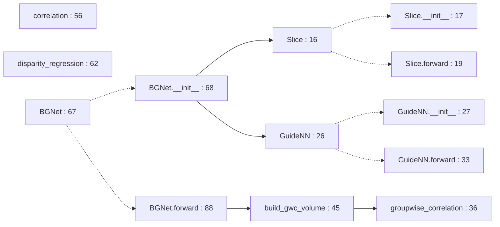

### `perception/BGNet/models/bgnet_plus.py`

Ideal placement: Vendored Torch inference implementation behind StereoDepthEstimator; concrete internal network composition is appropriate.

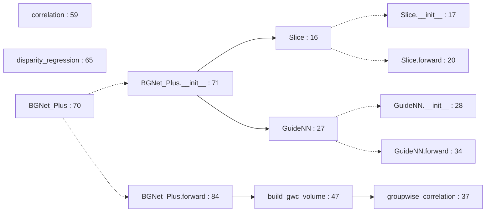

### `perception/BGNet/models/feature_extractor_fast.py`

Ideal placement: Vendored Torch inference implementation behind StereoDepthEstimator; concrete internal network composition is appropriate.

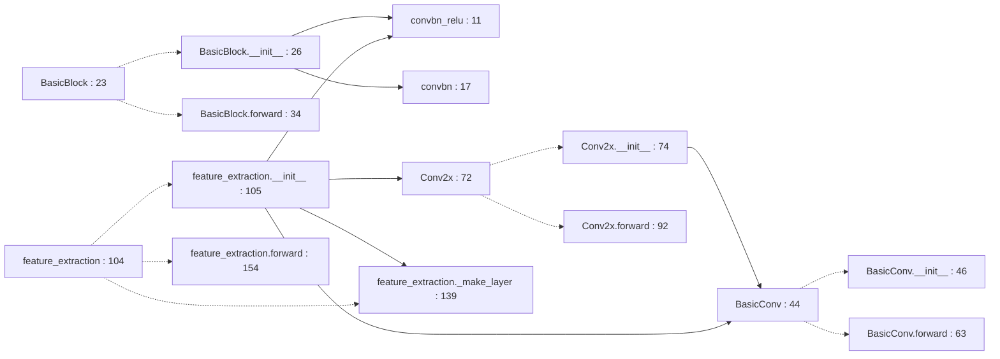

### `perception/BGNet/models/submodules.py`

Ideal placement: Vendored Torch inference implementation behind StereoDepthEstimator; concrete internal network composition is appropriate.

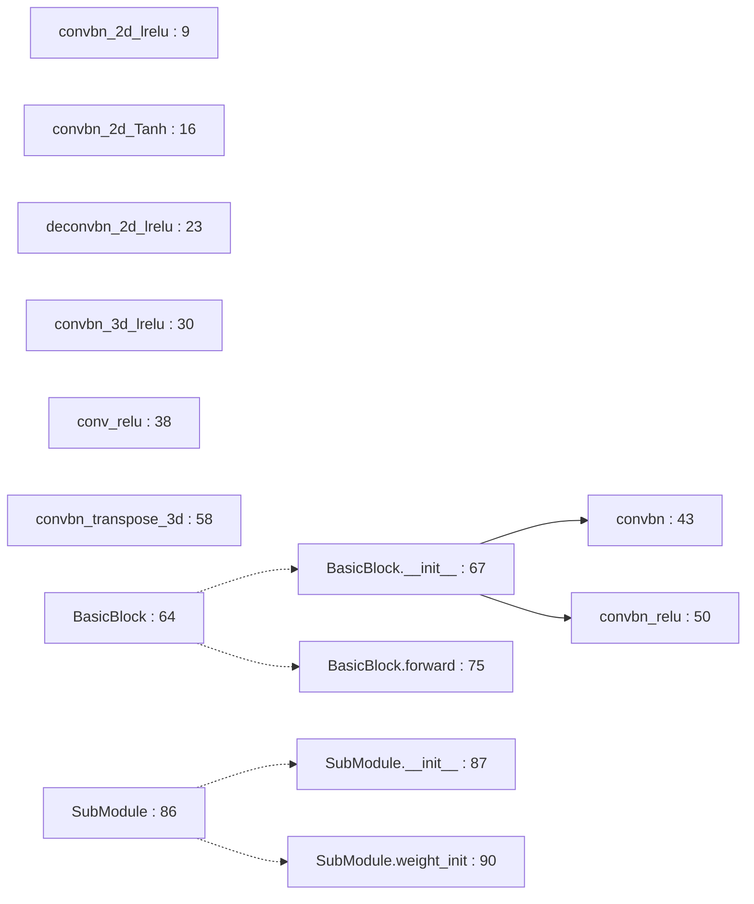

### `perception/BGNet/models/submodules2d.py`

Ideal placement: Vendored Torch inference implementation behind StereoDepthEstimator; concrete internal network composition is appropriate.

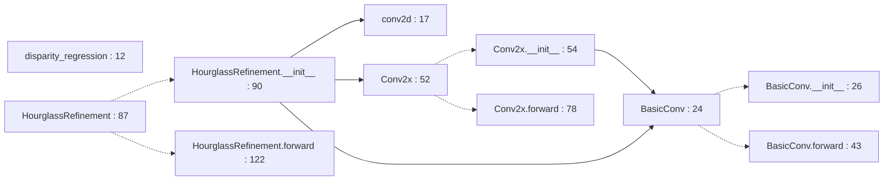

### `perception/BGNet/models/submodules3d.py`

Ideal placement: Vendored Torch inference implementation behind StereoDepthEstimator; concrete internal network composition is appropriate.

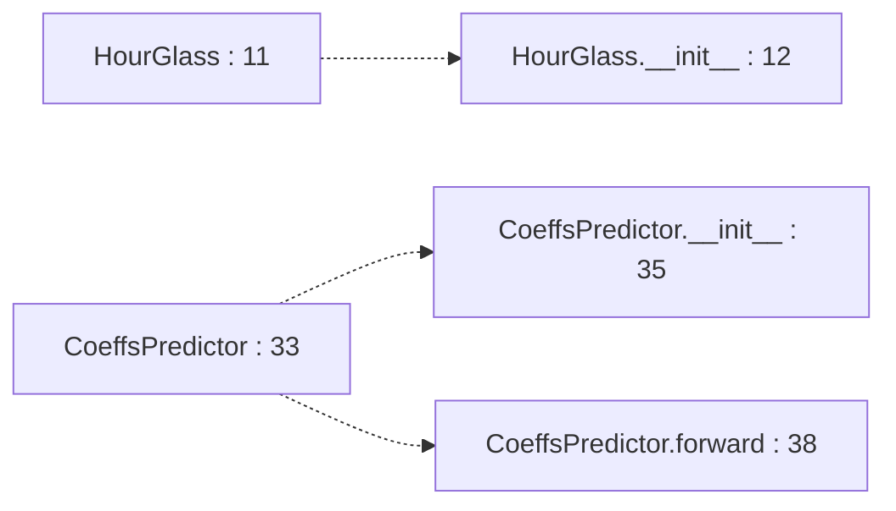

### `perception/BGNet/nets/warp.py`

Ideal placement: Vendored Torch inference implementation behind StereoDepthEstimator; concrete internal network composition is appropriate.

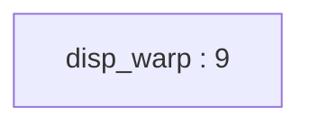

### `perception/BGNet/predict.py`

Ideal placement: Research CLI/composition adapter; keep model selection and filesystem outside the reusable depth policy.

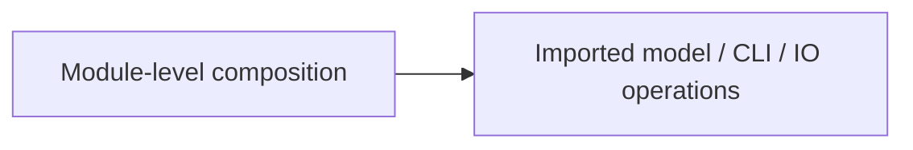

No local class/function definitions; operations run at module scope. See import-time lifecycle findings where applicable.

### `perception/BGNet/predict_sample.py`

Ideal placement: Research CLI/composition adapter; keep model selection and filesystem outside the reusable depth policy.

No local class/function definitions; operations run at module scope. See import-time lifecycle findings where applicable.

### `perception/__init__.py`

Ideal placement: Empty package marker; no executable policy or class interaction to partition.

No executable local symbol interaction (empty marker or import/registry facade).

### `perception/compute_depth.py`

Ideal placement: Depth use case plus constructed BGNet model adapter; remove import-time composition in a later migration.

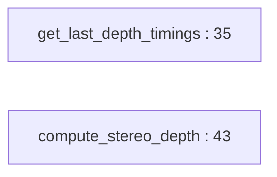

### `perception/depth_estimation.py`

Ideal placement: ROS synchronization/input-output adapter around depth use case.

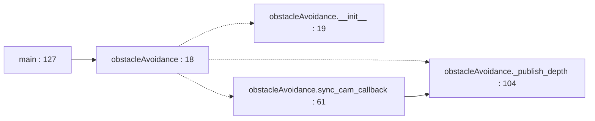
