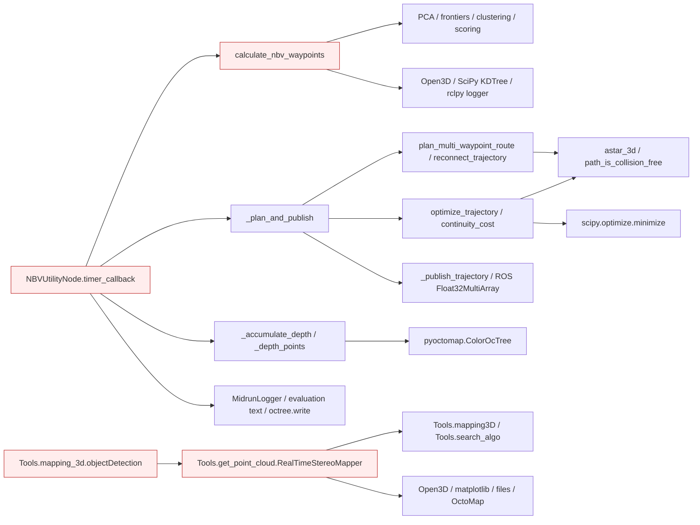
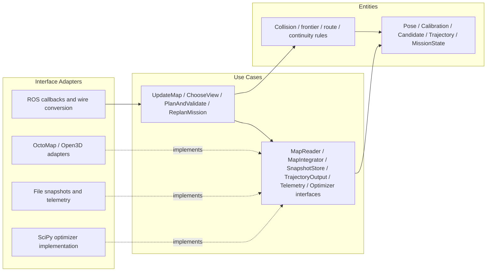
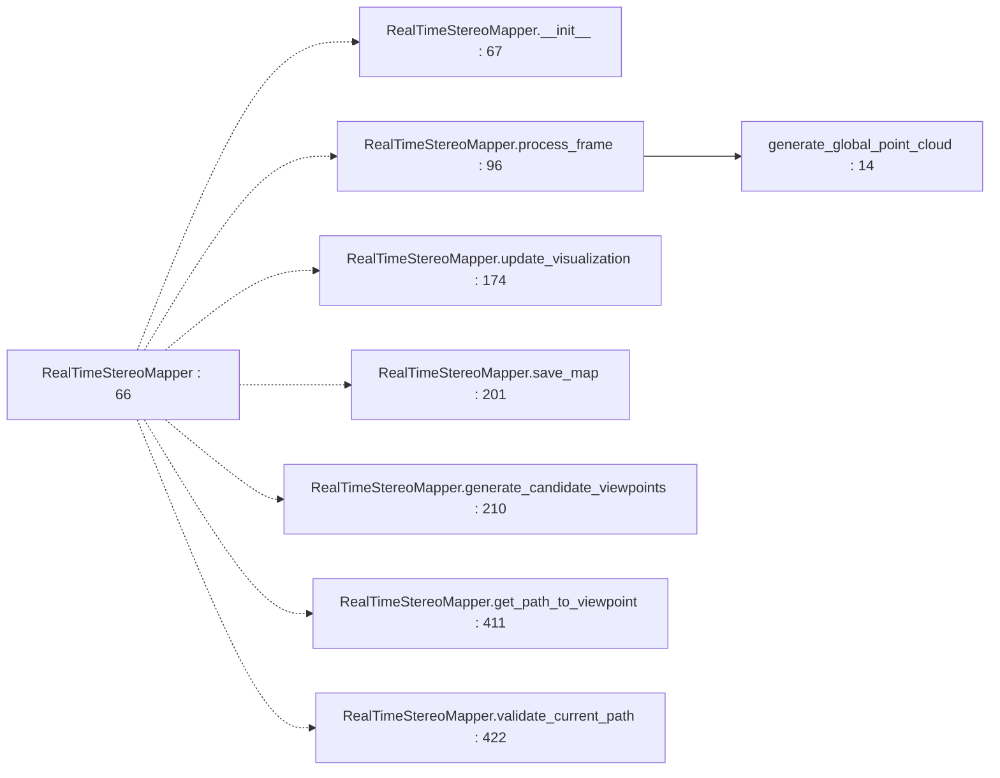
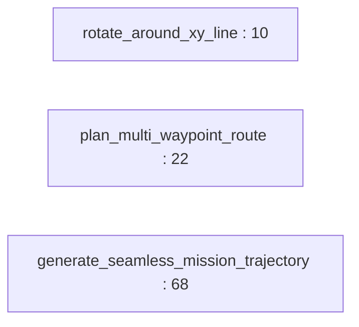
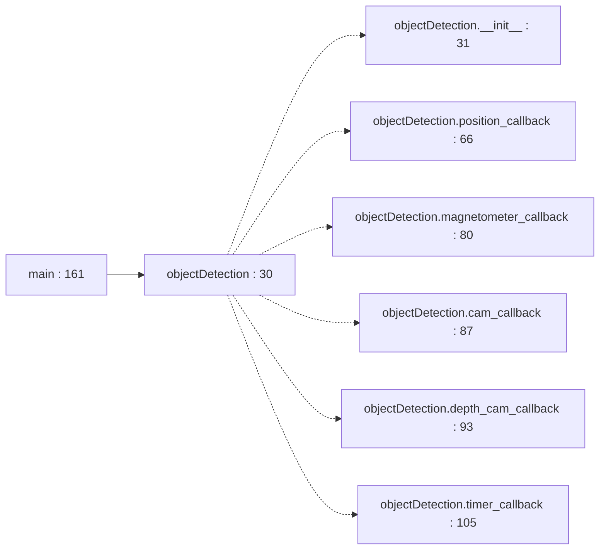
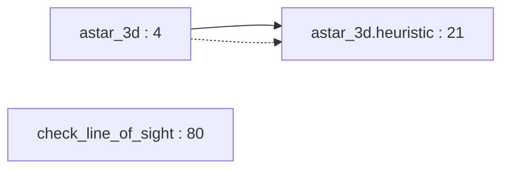
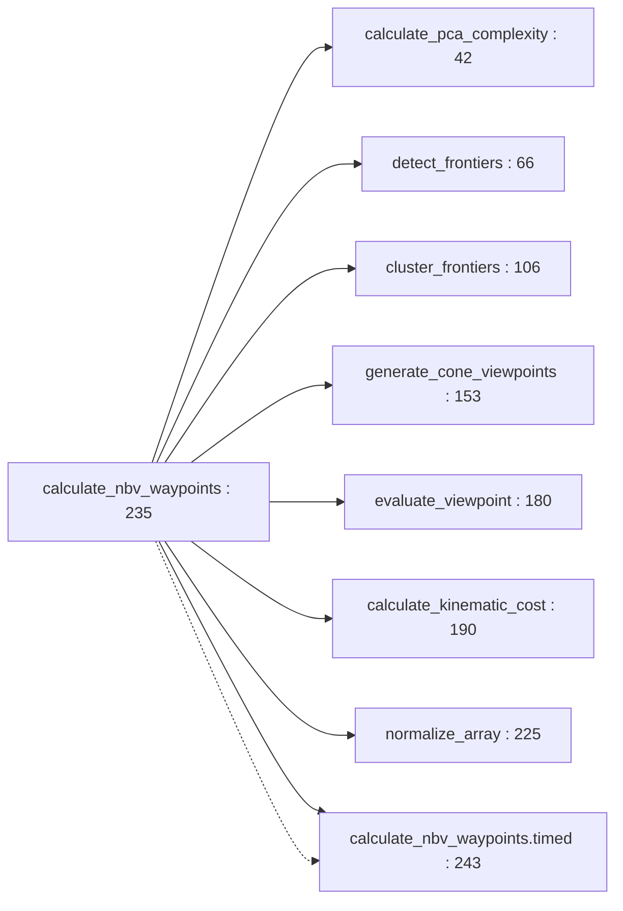
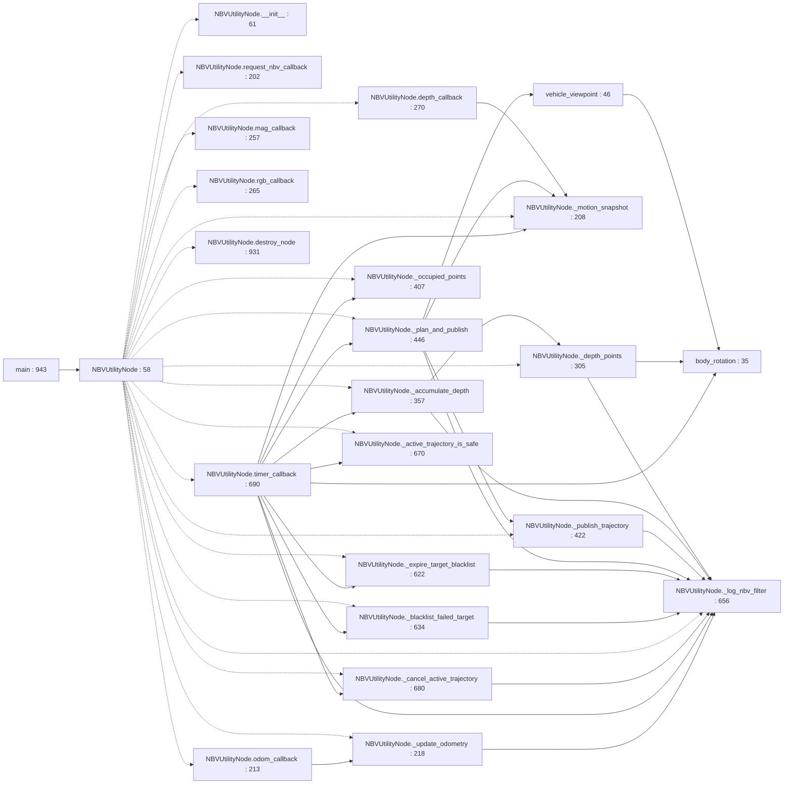
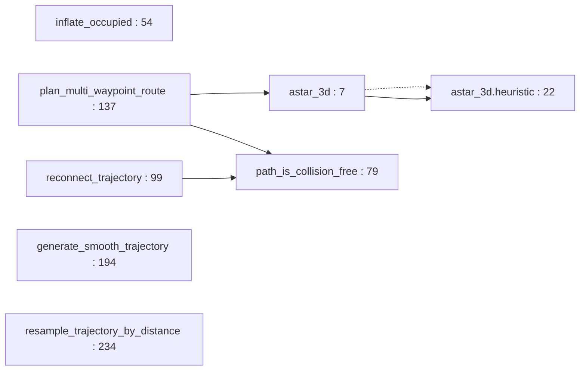
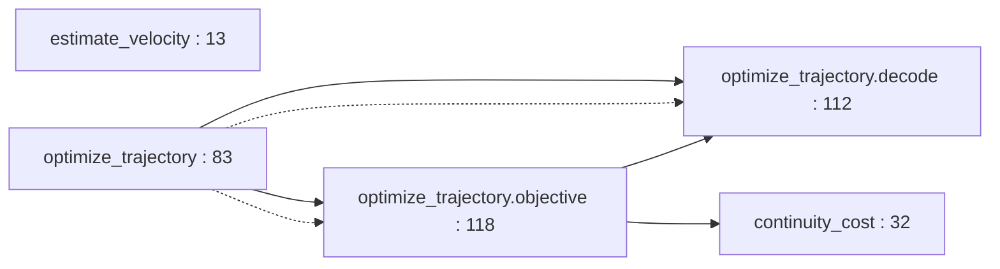

# Package Architecture Audit: auv_planner_reference

## Current Metrics

- Fan-in: 1 | Fan-out: 1
- Instability (I): 0.500
- Abstractness (A): 0.000 (Na=0; Nc=3)
- Distance (D): 0.500
- Status: Zone of Pain

Scope: Active NBV ROS planner with separate scoring, route and continuity functions, plus a legacy Tools mapping pipeline. Three concrete classes, no explicit abstract interfaces.

Counts use the observed source/deployment graph, not ROS topic flow. See [Phase 1 definitions and denominator conventions](../phase_1_topology.md#metric-definitions-and-counting-rules). An asterisk denotes a mathematically undefined denominator replaced by zero only for display; the resulting D/status is conditional. Classification alone is not a violation. All file paths below are relative to `NBV_paper_ros2/src`.

## Violations Found
| ID | Rule Broken | File & Line / Symbol | Concrete Issue | Actor / Architectural Impact |
|---|---|---|---|---|
| V-01 | SRP / DIP | `auv_planner_reference/auv_planner_reference/planner_node.py:58` / `NBVUtilityNode` | **Critical.** A single Node contains sensor conversion, map fusion, mission progression, target blacklisting, collision replanning, trajectory serialization and file persistence. Constructor creates OctoMap at line 155, MidrunLogger at 164 and evaluation file at 192. | Mission research, mapping, ROS integration and experiment reporting actors share one class; failures/changes cascade across policy and IO. |
| V-02 | DIP | `auv_planner_reference/auv_planner_reference/get_NBV.py:4` / `get_logger / calculate_nbv_waypoints` | **Moderate.** The NBV algorithm imports a ROS logger and constructs/filters Open3D point clouds inside policy (line 262); scoring helpers also take Open3D point-cloud objects. | Pure candidate/scoring use cases require framework/preprocessing dependencies even outside ROS; inject diagnostics and preprocessing output. |
| V-03 | DIP / CRP / ADP | `auv_planner_reference/auv_planner_reference/planner_node.py:19` / `MidrunLogger dependency` | **Moderate.** Mission code imports concrete experiment telemetry and accesses its filter_path (line 200), while benchmark orchestration depends back on the auv_bringup graph. | A logging implementation and result naming convention become production dependencies and participate in a deployment cycle. |
| V-04 | SRP / DIP | `auv_planner_reference/auv_planner_reference/Tools/get_point_cloud.py:66` / `legacy RealTimeStereoMapper` | **Moderate.** One class combines map fusion, candidate/path policy, direct Notes file writes, map persistence and visualization methods; constructor opens a file at 69 and creates ColorOcTree at 77. | Map/backend, display and algorithm actors modify one legacy implementation; it cannot serve as an independent domain mapper. |
| V-05 | REP / DIP | `auv_planner_reference/auv_planner_reference/Tools/mapping_3d.py:10` / `legacy Tools import routing` | **Low.** Absolute sys.path mutation plus top-level Tools imports bypass installed auv_planner_reference ownership. Tools/get_point_cloud.py:11 and Tools/mapping3D.py:8 use the same ambiguous namespace. | Reuse depends on checkout layout and may resolve a different repository Tools module. No out-of-scope implementation is assumed to be the intended provider. |
| V-06 | CCP / CRP | `auv_planner_reference/auv_planner_reference/Tools/mapping3D.py:22` / `parallel legacy planning pipeline` | **Moderate.** Legacy route/search/mapping implementations coexist with the active route_planning/get_NBV/Node pipeline in one source component, using distinct data/calibration and IO assumptions. | Consumers and maintainers must distinguish two change paths for the same capability; dormant code is not evidence that active mission execution calls it. |
| V-07 | DIP | `auv_planner_reference/auv_planner_reference/trajectory_optimization.py:139` / `optimize_trajectory` | **Moderate.** Trajectory acceptance policy directly invokes scipy.optimize.minimize with a fixed solver and options; no injectable optimization operation separates objective/validation from solver mechanics. | Replacing/timing/faking the solver requires modifying or monkey-patching policy. Retain collision and improvement checks in the use case, not the solver adapter. |
| V-08 | CCP / DIP | `auv_planner_reference/auv_planner_reference/planner_node.py:422` / `_publish_trajectory` | **Moderate.** Policy layer performs Float32 wire serialization/validation while control interprets an implicit x,y,z,yaw array convention; entity and adapter concerns meet inside the mission class. | Changing command precision/schema requires coordinated planner/control edits. Wire-safety checks remain necessary but belong at an explicit adapter contract. |
| V-09 | REP (dependency metadata) | `auv_planner_reference/package.xml:16` / `runtime dependencies` | **Moderate.** Active planner imports pyoctomap at planner_node.py:8 but the manifest and setup.py do not declare it; legacy modules add undeclared plotting/Pandas dependencies. | Declared package installation is insufficient to reproduce all shipped runtime imports. |

## Proposed Structural Boundary
- Interfaces to extract: `OccupancyReader`, `MapIntegrator`, `MapSnapshotStore`, `TrajectoryOutput`, `NBVTelemetry`, `Clock`, `PointCloudPreprocessor`, `TrajectoryOptimizer`; data contracts for Pose, CameraCalibration, Candidate, Trajectory and MissionState.
- Dependencies to invert or decouple: Extract mission transitions from Node callbacks; adapt ROS messages at entry/output. Inject map and persistence ports and supply telemetry from outer composition. Keep collision checks and continuity acceptance in policy even when an optimizer implementation is replaced.

## Current Internal Package Diagram

Solid arrows are calls, construction, field ownership or source dependencies as labeled. These diagrams summarize source relationships, not measured runtime execution; dormant paths are labeled. Red nodes mix policy with details.

## Ideal Clean Internal Package Diagram

This is a proposed partition, not an implemented structure. Ports are policy-owned abstract interfaces (Python Protocol/ABC, C++ pure virtual classes); implementations depend on them. Entities cross ports as plain values. A grouped port box means separate role-specific interfaces, never one mandatory aggregate interface.

## Principle Assessment and Non-Findings

Framework imports in actual policy are DIP findings; NumPy arithmetic and pure route functions are not automatically violations. The existing timing_callback in calculate_nbv_waypoints is a useful dependency-inversion seam despite the remaining global ROS logger. No strategy subclass contract failure is demonstrated (LSP), and no implemented fat abstract interface proves ISP. Parameterized weights already support extension without editing scoring; merely having conditional collision guards does not violate OCP. SAP: lack of stable policy contracts matters qualitatively; D=0.5 alone is insufficient evidence.

Actor labels are inferred responsibilities, not verified organizational roles. SOLID findings require responsibility, client or contract evidence; line count, inheritance, ordinary guards, framework adapters and missing abstract classes alone do not prove a violation. REP findings establish incomplete reuse/deployment contracts; no release-history audit was performed.

## Module-by-Module Target Placement

| File | Current defined classes / top-level functions | Ideal placement / diagnostic disposition |
|---|---|---|
| `auv_planner_reference/package.xml` | No classes/top-level Python functions | Release/build metadata; reconcile dependencies with source. No domain policy extraction. |
| `auv_planner_reference/auv_planner_reference/Tools/get_point_cloud.py` | `RealTimeStereoMapper:66`; `generate_global_point_cloud:14` | Split legacy mapping/planning policy from OctoMap, viewer and file adapters. |
| `auv_planner_reference/auv_planner_reference/Tools/mapping3D.py` | `rotate_around_xy_line:10`; `plan_multi_waypoint_route:22`; `generate_seamless_mission_trajectory:68` | Legacy route/spline math; consolidate only after behavior comparison with active policy. |
| `auv_planner_reference/auv_planner_reference/Tools/mapping_3d.py` | `objectDetection:30`; `main:161` | Legacy ROS adapter and mission use case; explicit telemetry adapters. |
| `auv_planner_reference/auv_planner_reference/Tools/search_algo.py` | `astar_3d:4`; `check_line_of_sight:80` | Pure search and visibility rules over occupancy values; preserve. |
| `auv_planner_reference/auv_planner_reference/__init__.py` | No classes/top-level Python functions | Empty package marker; no executable policy or class interaction to partition. |
| `auv_planner_reference/auv_planner_reference/get_NBV.py` | `calculate_pca_complexity:42`; `detect_frontiers:66`; `cluster_frontiers:106`; `generate_cone_viewpoints:153`; `evaluate_viewpoint:180`; `calculate_kinematic_cost:190`; `normalize_array:225`; `calculate_nbv_waypoints:235` | Candidate-selection use case plus entity math; extract Open3D preprocessing and ROS diagnostics. |
| `auv_planner_reference/auv_planner_reference/planner_node.py` | `NBVUtilityNode:58`; `body_rotation:35`; `vehicle_viewpoint:46`; `main:943` | Split ROS adapter, mission use cases, map/file/telemetry adapters; retain pose helpers as entity math. |
| `auv_planner_reference/auv_planner_reference/route_planning.py` | `astar_3d:7`; `inflate_occupied:54`; `path_is_collision_free:79`; `reconnect_trajectory:99`; `plan_multi_waypoint_route:137`; `generate_smooth_trajectory:194`; `resample_trajectory_by_distance:234` | Route/collision use cases and entity math; put spline library implementation behind a boundary only where replacement is required. |
| `auv_planner_reference/auv_planner_reference/trajectory_optimization.py` | `estimate_velocity:13`; `continuity_cost:32`; `optimize_trajectory:83` | Continuity objective and acceptance in policy; SciPy execution in optimizer adapter. |
| `auv_planner_reference/setup.cfg` | No classes/top-level Python functions | Release/build metadata; reconcile dependencies with source. No domain policy extraction. |
| `auv_planner_reference/setup.py` | No classes/top-level Python functions | Release/build metadata; reconcile dependencies with source. No domain policy extraction. |
| `auv_planner_reference/test/test_copyright.py` | `test_copyright:23` | Test-only consumer; excluded from production metrics. Static review only; no test execution claimed. |
| `auv_planner_reference/test/test_flake8.py` | `test_flake8:21` | Test-only consumer; excluded from production metrics. Static review only; no test execution claimed. |
| `auv_planner_reference/test/test_motion_continuity.py` | `trajectory:13`; `test_velocity_uses_world_pose_history_and_irregular_timestamps:18`; `test_candidate_order_prefers_forward_motion_but_allows_required_return:27`; `test_reversal_and_full_yaw_turn_have_higher_cost:40`; `test_recent_retracing_is_penalized_without_penalizing_departure:51`; `test_gradual_spatial_loop_is_penalized_even_with_constant_yaw:58`; `test_spline_positions_are_independent_of_target_heading:65`; `test_optimizer_improves_entry_and_preserves_boundary_and_step_lengths:74`; `test_optimizer_keeps_collision_safe_route_in_narrow_corridor:86`; `test_collision_check_rejects_single_occupied_point_and_nan:96`; `test_yaw_wrap_is_shortest_rotation_and_stationary_velocity_is_safe:101`; `test_delayed_plan_starts_at_latest_pose_and_drops_passed_prefix:111`; `test_delayed_entry_rejects_collision_on_new_connector:122`; `test_delayed_entry_preserves_required_turn_and_short_yaw_wrap:132`; `test_delayed_entry_handles_stationary_single_and_duplicate_samples:141` | Test-only consumer; excluded from production metrics. Static review only; no test execution claimed. |
| `auv_planner_reference/test/test_nbv_config.py` | `test_split_nbv_config_contains_supported_tuning_parameters:9` | Test-only consumer; excluded from production metrics. Static review only; no test execution claimed. |
| `auv_planner_reference/test/test_nbv_filter_logging.py` | `Cloud:42`; `load_file:20`; `pipeline:34`; `test_empty_pipeline_returns_no_candidates:88`; `test_timing_preserves_candidates:113`; `test_pose_history_removes_matching_frontier:126`; `test_cluster_rejects_groups_below_minimum_sample_count:134`; `test_node_nbv_call_matches_restored_signature:146`; `test_pipeline_passes_complexity_weight_to_gain_calculation:157`; `test_astar_return_matches_occupied_endpoints_and_expansion_limit:177`; `test_collision_rejects_occupied_voxel_between_endpoints:182`; `test_route_skips_occupied_viewpoint:188`; `test_jsonl_logs_iteration_and_handles_nonfinite_values:196`; `node_method:207`; `test_node_reports_utility_removing_all_candidates:223`; `test_depth_range_diagnostics_count_disjoint_rejections:233`; `test_disabled_node_logging_does_not_access_logger_or_files:247`; `test_blocked_route_cancellation_reaches_downstream_queue:252`; `test_depth_sensor_mount_offset_rotates_with_vehicle:268`; `test_vehicle_viewpoint_places_rotated_mount_at_requested_camera_position:281`; `test_rejected_combined_spline_keeps_checked_first_structural_target:297`; `test_vehicle_route_is_checked_instead_of_camera_offset_route:344`; `test_wire_validation_rejects_float32_rounding_into_occupied_voxel:356`; `test_failed_target_blacklist_expires_and_requests_another_target:368`; `test_failed_target_blacklist_deduplicates_nearby_cluster_drift:394`; `test_global_failure_or_disabled_cooldown_does_not_ban_a_target:409` | Test-only consumer; excluded from production metrics. Static review only; no test execution claimed. |
| `auv_planner_reference/test/test_nbv_math.py` | `test_viewpoint_gain_uses_configured_complexity_weight:24`; `test_pca_matches_original_covariance_formula:33`; `test_frontiers_match_original_angular_gap_formula:47`; `test_frontiers_handle_small_and_duplicate_clouds:72`; `test_greedy_clustering_keeps_order_and_discards_small_clusters:78`; `test_viewpoint_gain_matches_original_and_skips_coincident_point:89` | Test-only consumer; excluded from production metrics. Static review only; no test execution claimed. |
| `auv_planner_reference/test/test_pep257.py` | `test_pep257:21` | Test-only consumer; excluded from production metrics. Static review only; no test execution claimed. |
| `auv_planner_reference/test/test_route_search_limits.py` | `test_runtime_callers_match_restored_route_planning_signatures:12`; `test_astar_preserves_detours_around_obstacles:39`; `test_resampling_handles_duplicate_and_stationary_points:49` | Test-only consumer; excluded from production metrics. Static review only; no test execution claimed. |

## Class Counting Evidence

- `auv_planner_reference/auv_planner_reference/Tools/get_point_cloud.py`: `RealTimeStereoMapper` (line 66).
- `auv_planner_reference/auv_planner_reference/Tools/mapping_3d.py`: `objectDetection` (line 30).
- `auv_planner_reference/auv_planner_reference/planner_node.py`: `NBVUtilityNode` (line 58).

## Function and Class Interaction Detail

The following module diagrams are static Python AST call/name and class-containment maps. Dotted edges indicate containment, solid edges an explicit local call. Repeated method names are resolved within the containing class; nested functions belong to their lexical owner. Dynamic dispatch, callbacks registered for later execution and arbitrary imported calls are not inferred as exact call edges. Package diagrams above supply the cross-module and C++ relationships. See [source coverage](../source_coverage.md) for all imports, C++ includes and function symbols.

### `auv_planner_reference/Tools/get_point_cloud.py`

Ideal placement: Split legacy mapping/planning policy from OctoMap, viewer and file adapters.

### `auv_planner_reference/Tools/mapping3D.py`

Ideal placement: Legacy route/spline math; consolidate only after behavior comparison with active policy.

### `auv_planner_reference/Tools/mapping_3d.py`

Ideal placement: Legacy ROS adapter and mission use case; explicit telemetry adapters.

### `auv_planner_reference/Tools/search_algo.py`

Ideal placement: Pure search and visibility rules over occupancy values; preserve.

### `auv_planner_reference/__init__.py`

Ideal placement: Empty package marker; no executable policy or class interaction to partition.

No executable local symbol interaction (empty marker or import/registry facade).

### `auv_planner_reference/get_NBV.py`

Ideal placement: Candidate-selection use case plus entity math; extract Open3D preprocessing and ROS diagnostics.

### `auv_planner_reference/planner_node.py`

Ideal placement: Split ROS adapter, mission use cases, map/file/telemetry adapters; retain pose helpers as entity math.

### `auv_planner_reference/route_planning.py`

Ideal placement: Route/collision use cases and entity math; put spline library implementation behind a boundary only where replacement is required.

### `auv_planner_reference/trajectory_optimization.py`

Ideal placement: Continuity objective and acceptance in policy; SciPy execution in optimizer adapter.

