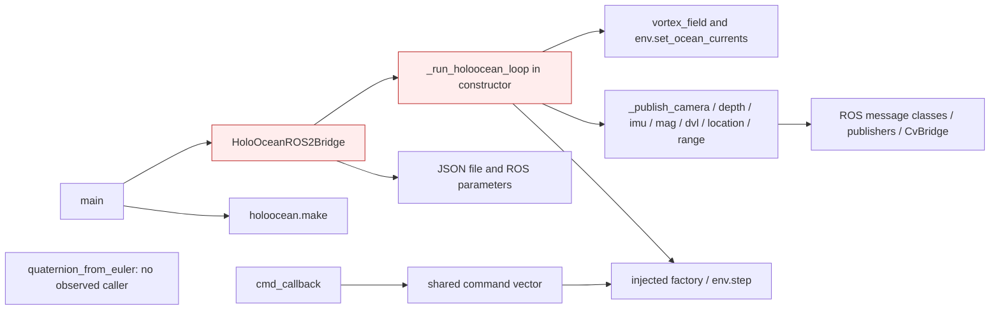
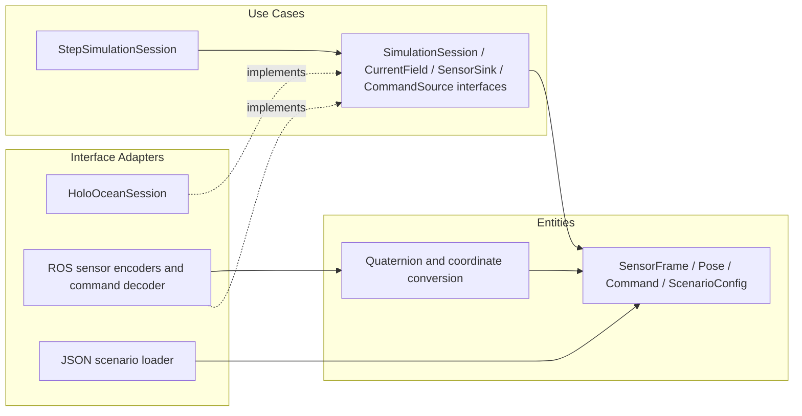
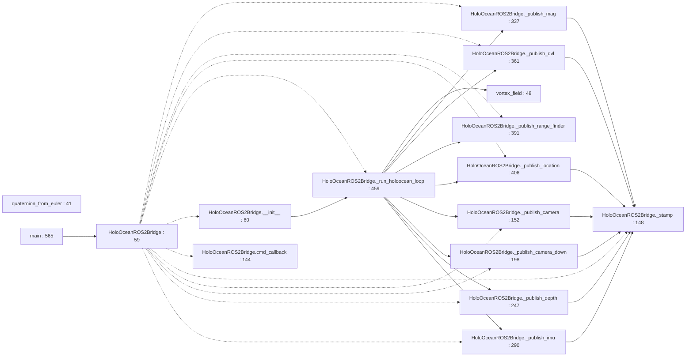

# Package Architecture Audit: auv_sim_bridge

## Current Metrics

- Fan-in: 1 | Fan-out: 0
- Instability (I): 0.000
- Abstractness (A): 0.000 (Na=0; Nc=1)
- Distance (D): 1.000
- Status: Zone of Pain

Scope: One ROS/HoloOcean adapter class with sensor conversion helpers and a synchronous simulation loop. Framework dependence is expected here; missing internal seams and lifecycle mixing are the issues.

Counts use the observed source/deployment graph, not ROS topic flow. See [Phase 1 definitions and denominator conventions](../phase_1_topology.md#metric-definitions-and-counting-rules). An asterisk denotes a mathematically undefined denominator replaced by zero only for display; the resulting D/status is conditional. Classification alone is not a violation. All file paths below are relative to `NBV_paper_ros2/src`.

## Violations Found
| ID | Rule Broken | File & Line / Symbol | Concrete Issue | Actor / Architectural Impact |
|---|---|---|---|---|
| V-01 | SRP | `auv_sim_bridge/auv_sim_bridge/holoocean_node.py:59` / `HoloOceanROS2Bridge` | **Moderate.** One class loads scenario JSON, initializes middleware, owns command state, steps the simulator and encodes every sensor; construction calls the blocking loop at line 136. | Simulator lifecycle, deployment configuration and ROS sensor-schema actors change the same class; construction and use cannot be tested independently. |
| V-02 | OCP | `auv_sim_bridge/auv_sim_bridge/holoocean_node.py:478` / `sensor dispatch in _run_holoocean_loop` | **Moderate.** The loop enumerates sensor names and per-sensor try/publish branches; a new sensor requires editing the central stepping loop as well as implementing conversion. | Sensor extension changes simulator scheduling infrastructure; a registry of sensor adapters would localize those changes. |
| V-03 | CCP / DIP (protocol boundary) | `auv_sim_bridge/auv_sim_bridge/holoocean_node.py:122` / `command vector / cmd_callback` | **Moderate.** The shared default eight-element command and Float32MultiArray input go directly to env.step at line 475, sharing the controller’s platform-specific index convention. | Vehicle command-layout changes require coordinated bridge/controller edits; define command values and perform simulator-specific translation at the adapter boundary. |
| V-04 | REP (dependency metadata) | `auv_sim_bridge/package.xml:11` / `dependency declarations` | **Moderate.** Manifest has only test dependencies although runtime imports rclpy, ROS message packages, cv_bridge, NumPy and HoloOcean (main); setup.py declares only setuptools. | The installed component metadata does not state the runtime prerequisites needed by deployment consumers. |
| V-05 | SRP / DIP | `auv_sim_bridge/auv_sim_bridge/holoocean_node.py:548` / `vortex_field / set_ocean_currents` | **Moderate.** Sensor handling also computes an experiment-specific vortex field and directly applies it to the hardcoded auv0 simulator agent at line 549. | Environmental experiment policy shares the sensor transport/stepping loop; inject CurrentField and scenario-owned agent selection so transport changes do not alter experimental conditions. |

## Proposed Structural Boundary
- Interfaces to extract: `SimulationSession` (step/close), `CurrentField`, `CommandSource`, narrow per-sensor output sinks and `ScenarioLoader`; pure SensorFrame/Pose/Command values.
- Dependencies to invert or decouple: Retain injected holoocean_make_fn and separate construction from running. Isolate scenario loading, simulator stepping and ROS sensor encoding; register sensor adapters outside the step loop.

## Current Internal Package Diagram

Solid arrows are calls, construction, field ownership or source dependencies as labeled. These diagrams summarize source relationships, not measured runtime execution; dormant paths are labeled. Red nodes mix policy with details.

## Ideal Clean Internal Package Diagram

This is a proposed partition, not an implemented structure. Ports are policy-owned abstract interfaces (Python Protocol/ABC, C++ pure virtual classes); implementations depend on them. Entities cross ports as plain values. A grouped port box means separate role-specific interfaces, never one mandatory aggregate interface.

## Principle Assessment and Non-Findings

holoocean_make_fn injection already supports a test seam, so the report does not claim a direct hardcoded simulator constructor inside the class. Driver/framework use in this outer adapter is not a Dependency Rule violation by itself. The superclass Node contract was not shown to promise nonblocking constructors; therefore constructor blocking is reported as SRP/lifecycle coupling, not an invented LSP violation. No scoped ADP/SDP edge or confirmed ISP violation exists; its D=1 does not justify abstracting every sensor helper.

Actor labels are inferred responsibilities, not verified organizational roles. SOLID findings require responsibility, client or contract evidence; line count, inheritance, ordinary guards, framework adapters and missing abstract classes alone do not prove a violation. REP findings establish incomplete reuse/deployment contracts; no release-history audit was performed.

## Module-by-Module Target Placement

| File | Current defined classes / top-level functions | Ideal placement / diagnostic disposition |
|---|---|---|
| `auv_sim_bridge/package.xml` | No classes/top-level Python functions | Release/build metadata; reconcile dependencies with source. No domain policy extraction. |
| `auv_sim_bridge/setup.cfg` | No classes/top-level Python functions | Release/build metadata; reconcile dependencies with source. No domain policy extraction. |
| `auv_sim_bridge/setup.py` | No classes/top-level Python functions | Release/build metadata; reconcile dependencies with source. No domain policy extraction. |
| `auv_sim_bridge/auv_sim_bridge/__init__.py` | No classes/top-level Python functions | Empty package marker; no executable policy or class interaction to partition. |
| `auv_sim_bridge/auv_sim_bridge/holoocean_node.py` | `HoloOceanROS2Bridge:59`; `quaternion_from_euler:41`; `vortex_field:48`; `main:565` | Separate simulator session, ROS sensor adapters, configuration loader and pure conversion math. |
| `auv_sim_bridge/test/test_copyright.py` | `test_copyright:23` | Test-only consumer; excluded from production metrics. Static review only; no test execution claimed. |
| `auv_sim_bridge/test/test_flake8.py` | `test_flake8:21` | Test-only consumer; excluded from production metrics. Static review only; no test execution claimed. |
| `auv_sim_bridge/test/test_pep257.py` | `test_pep257:21` | Test-only consumer; excluded from production metrics. Static review only; no test execution claimed. |

## Class Counting Evidence

- `auv_sim_bridge/auv_sim_bridge/holoocean_node.py`: `HoloOceanROS2Bridge` (line 59).

## Function and Class Interaction Detail

The following module diagrams are static Python AST call/name and class-containment maps. Dotted edges indicate containment, solid edges an explicit local call. Repeated method names are resolved within the containing class; nested functions belong to their lexical owner. Dynamic dispatch, callbacks registered for later execution and arbitrary imported calls are not inferred as exact call edges. Package diagrams above supply the cross-module and C++ relationships. See [source coverage](../source_coverage.md) for all imports, C++ includes and function symbols.

### `auv_sim_bridge/__init__.py`

Ideal placement: Empty package marker; no executable policy or class interaction to partition.

No executable local symbol interaction (empty marker or import/registry facade).

### `auv_sim_bridge/holoocean_node.py`

Ideal placement: Separate simulator session, ROS sensor adapters, configuration loader and pure conversion math.

