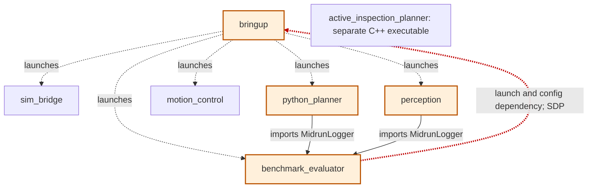
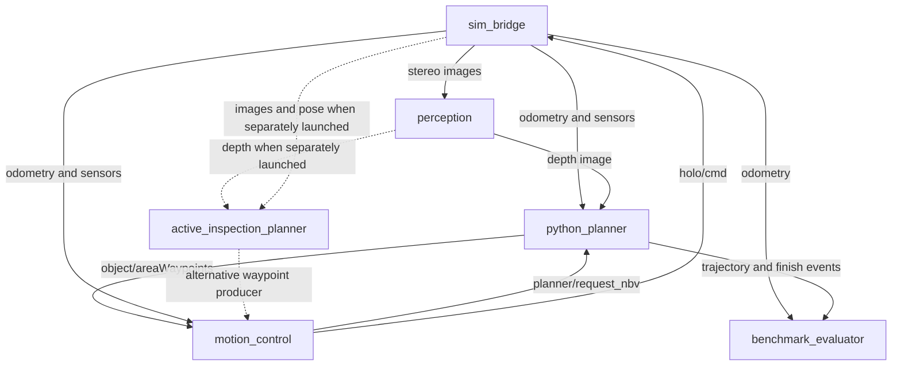
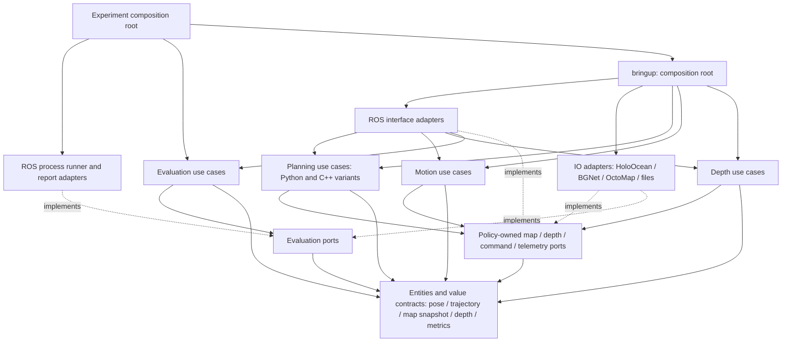

# Phase 1: Package Topology and Component Metrics

Audit date: 2026-10-05. Scope: the seven `package.xml` components under `NBV_paper_ros2/src`, including dormant source and vendored BGNet. Paths in evidence are relative to that directory. Source code was not changed or executed. See the [master report](clean_architecture_audit_summary.md) and [source coverage](source_coverage.md).

BGNet is a Git submodule pinned at `19b9c1bc17ebf653b344e52470ae6f85953c17a9`, with separate upstream provenance. It has no standalone ROS manifest or Python distribution setup in this tree; its internal modules and 19 classes are included in perception's 20-class count. This measures deployed ROS components rather than treating every Git or Python namespace as a peer release unit.

## Current Inter-Package Dependency Graph

Arrows mean **dependent → dependency**. Solid edges are Python imports (also declared in manifests); dashed edges are package names or resources explicitly referenced by executable launch/orchestration source. Both impose component change dependencies; dashed edges are not compiler imports. Topic feedback is excluded from this graph.

| Dependency | Exact source evidence | Kind |
|---|---|---|
| bringup → sim_bridge | `bringup/launch/mapper.launch.py:46` | Deployment |
| bringup → perception | `bringup/launch/mapper.launch.py:52` | Deployment |
| bringup → motion_control | `bringup/launch/mapper.launch.py:58`, `:64` | Deployment; count once |
| bringup → python_planner | `bringup/launch/mapper.launch.py:70` | Deployment |
| bringup → benchmark_evaluator | `bringup/launch/mapper.launch.py:77` | Deployment |
| python_planner → benchmark_evaluator | `python_planner/python_planner/planner_node.py:19` | Import plus manifest |
| perception → benchmark_evaluator | `perception/perception/depth_estimation.py:13` | Import plus manifest |
| benchmark_evaluator → bringup | `benchmark_evaluator/benchmark_evaluator/optuna_optimizer.py:12`, `:63` | Configuration and process launch |

All elementary cycles in this eight-edge component graph, modulo rotation:

1. `benchmark_evaluator → bringup → benchmark_evaluator`.
2. `benchmark_evaluator → bringup → perception → benchmark_evaluator`.
3. `benchmark_evaluator → bringup → python_planner → benchmark_evaluator`.

The import-only and internal manifest-only graphs contain just `perception → benchmark_evaluator` and `python_planner → benchmark_evaluator`, and have **no cycles**. The ADP findings concern the broader release/deployment component graph, not a claim of cyclic Python imports. The C++ planner is neither imported by another scoped package nor launched by the current bringup file. Isolation does not imply absence of ROS consumers when separately launched.

## External Dependencies and Runtime Topology

The [coverage inventory](source_coverage.md) lists every source import/include and manifest dependency, including standard libraries, framework packages and unresolved imports. These dependencies remain visible but are excluded from the closed seven-component metric graph: their own fan-in and source classes are outside scope. Counting their outgoing edges while omitting their incoming clients would bias I upward.

```mermaid
graph TD
    AI[active_inspection_planner] --> CXX[rclcpp and ROS messages]
    AI --> GEO[OctoMap / OpenCV / PCL / Eigen / tf2]
    MC[motion_control] --> CXX
    MC --> JSON[nlohmann_json: build linkage]
    MC -. legacy imports .-> ROOT[Out-of-scope repository Tools and routeCalculation]
    PP[python_planner] --> PYROS[rclpy / ROS messages / cv_bridge]
    PP --> MAP[pyoctomap / Open3D / NumPy / SciPy]
    PP -. legacy absolute imports .-> ROOT
    PP --> FS[Filesystem / JSON / time]
    PE[perception] --> PYROS
    PE --> MF[message_filters]
    PE --> ML[BGNet internal / PyTorch / torchvision / PIL / OpenCV]
    BE[benchmark_evaluator] --> PYROS
    BE --> MAP
    BE --> EXP[Optuna / YAML / subprocess / matplotlib / pandas]
    BE --> FS
    BR[bringup] --> LAUNCH[launch / launch_ros / ament_index_python]
    SB[sim_bridge] --> PYROS
    SB --> HOLO[HoloOcean / NumPy / JSON / time]
```

Runtime message flow is a separate view; these edges do not contribute to Ca/Ce:

## Metric Definitions and Counting Rules

- Ca/Fan-in = distinct scoped components depending on this component; Ce/Fan-out = distinct scoped components this component depends on. The primary table uses the eight observed import/deployment/resource edges above, including undeclared edges and dormant optimizer source. No duplicate edges, self-edges, topic edges, tests or transitive edges are counted. This is package-neighbor coupling, as requested, not a count of individual client classes.
- `I = Ce / (Ca + Ce)`; `A = Na / Nc`, where Nc is all locally defined production classes and C++ structs, and Na is explicitly abstract classes/interfaces. Functions, aliases, imported base classes and test classes do not enter Nc. AST inventories include nested classes; C++ declarations are counted once at their definition. BGNet classes belong to perception's release unit. Framework inheritance alone does not make a concrete node or network abstract. `SubModule` and `HourGlass` have no declared abstract methods and are not counted as interfaces.
- `D = |A + I - 1|`. `I` is mathematically undefined for the isolated C++ component; `A` is undefined for the class-free bringup package. To supply the requested numeric table, `0.000*` is an explicit display/imputation convention for these denominators, **not a measured zero**. Their D/status values and aggregate including them are conditional. The mathematically defined subset is also reported.
- Audit classification convention: D ≤ 0.100 is Balanced; otherwise A + I < 1 is Zone of Pain, and A + I > 1 is Zone of Uselessness. The threshold is an audit convention, not a universal Martin cutoff. A low D does not establish Clean Architecture; stable data and framework adapters can legitimately be concrete. Metrics identify review candidates, not automatic violations.

## Component Metrics Summary Table

| Package | Fan-in | Fan-out | Na | Nc | I | A | D | Classification |
|---|---:|---:|---:|---:|---:|---:|---:|---|
| active_inspection_planner | 0 | 0 | 0 | 7 | 0.000* | 0.000 | 1.000* | Zone of Pain*; isolated |
| benchmark_evaluator | 3 | 1 | 0 | 2 | 0.250 | 0.000 | 0.750 | Zone of Pain |
| bringup | 1 | 5 | 0 | 0 | 0.833 | 0.000* | 0.167* | Zone of Pain*; class-free |
| motion_control | 1 | 0 | 0 | 4 | 0.000 | 0.000 | 1.000 | Zone of Pain |
| perception | 1 | 1 | 0 | 20 | 0.500 | 0.000 | 0.500 | Zone of Pain |
| python_planner | 1 | 1 | 0 | 3 | 0.500 | 0.000 | 0.500 | Zone of Pain |
| sim_bridge | 1 | 0 | 0 | 1 | 0.000 | 0.000 | 1.000 | Zone of Pain |

The only strictly increasing-I edge (SDP violation under this scope) is `benchmark_evaluator (0.250) → bringup (0.833)`. Equal I is not labeled an SDP violation. No abstract component is present, so no measured Zone of Uselessness appears. motion_control/sim_bridge sit at the closed-workspace graph's concrete sink corner; that alone is not proof they need abstract ROS nodes. Separate stable policy contracts from these deployment details.

Import-only sensitivity: perception and python_planner each have Ca=0, Ce=1, I=1, A=0, D=0; benchmark_evaluator has Ca=2, Ce=0, I=0, A=0, D=1; all other components have undefined I. This radically different result is why the graph definition is part of the audit.

## Clean Architecture Target Dependency Graph

Proposed source/release components, not changes implemented by this audit. Every arrow points from an outer component to an inner policy/contract component. Dotted implementation edges still denote source dependence. Runtime callbacks can travel against these arrows. Contracts are owned by their policy clients and accept plain values, never ROS messages, Open3D clouds, Torch tensors or OctoMap handles.

`PORT`/`IO`/`ROS` are visual groupings of role-specific packages, not proposals for universal shared interfaces or monolithic utility packages. Keep map queries, map writes, telemetry, control output and depth inference separate. Implementation adapters contain their respective framework dependencies; core use cases do not import adapter modules. Numerical libraries can remain implementation details where they do not leak IO/framework state; a replaceable SciPy solver gets its own port rather than wrapping every NumPy operation.

The target DAG has no ADP cycles. With unique direct neighbors as drawn, I decreases or stays equal on every edge (this can be verified from its adjacency list). Outer experiment wiring depends on application composition and passes a launch specification into the generic process runner; application composition does not depend on experiment orchestration. High-fan-in contract components should be predominantly abstract; concrete immutable entity types are a deliberate SAP exception, not a reason to add meaningless interfaces. Exact target A/D cannot be computed before defining target classes and deployment units.

## Principles Used

The dependency rule separates policy from framework and IO details; dynamic dispatch permits calls outward while source dependencies remain inward. See Robert C. Martin, [The Clean Architecture](https://blog.cleancoder.com/uncle-bob/2012/08/13/the-clean-architecture.html). Component stability, abstraction and acyclicity are assessed using Martin's [Granularity](https://objectmentor.com/resources/articles/granularity.pdf) and [Stability](https://objectmentor.com/resources/articles/stability.pdf). Actor ownership in the reports is inferred from code responsibilities; actual team ownership and release history were not supplied.
