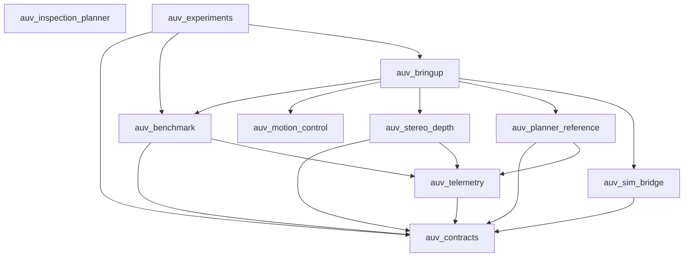

# Implemented component topology and metrics

Snapshot of the ten current ROS packages. Arrows mean dependent → dependency.
Edges combine production imports and internal runtime/build manifest dependencies (including launch closure).
External libraries, topic flow, tests and transitive edges are excluded.

Detected cycles: **none**.
Strictly increasing-instability edges: **none**.

## Metrics

Ca/Ce are distinct package neighbors. Nc counts production Python classes/C++ class and struct definitions;
Na counts explicit Protocol/ABC definitions and pure-virtual C++ interfaces. Packaging/test classes are excluded.
Vendored BGNet source remains counted as in the original audit, including checkout-only research classes.
`I = Ce/(Ca+Ce)`, `A = Na/Nc`, `D = |A+I-1|`. The original audit threshold D ≤ 0.100 is retained.
An asterisk marks a zero imputation for an undefined denominator and conditional D/classification.

| Package | Fan-in | Fan-out | Na | Nc | I | A | D | Classification |
|---|---:|---:|---:|---:|---:|---:|---:|---|
| auv_inspection_planner | 0 | 0 | 9 | 31 | 0.000* | 0.290 | 0.710* | Zone of Pain* |
| auv_contracts | 6 | 0 | 17 | 27 | 0.000 | 0.630 | 0.370 | Zone of Pain |
| auv_experiments | 0 | 3 | 0 | 2 | 1.000 | 0.000 | 0.000 | Balanced |
| auv_benchmark | 2 | 2 | 2 | 9 | 0.500 | 0.222 | 0.278 | Zone of Pain |
| auv_bringup | 1 | 5 | 0 | 0 | 0.833 | 0.000* | 0.167* | Zone of Pain* |
| auv_motion_control | 1 | 0 | 9 | 25 | 0.000 | 0.360 | 0.640 | Zone of Pain |
| auv_stereo_depth | 1 | 2 | 1 | 23 | 0.667 | 0.043 | 0.290 | Zone of Pain |
| auv_planner_reference | 1 | 2 | 0 | 8 | 0.667 | 0.000 | 0.333 | Zone of Pain |
| auv_sim_bridge | 1 | 1 | 4 | 11 | 0.500 | 0.364 | 0.136 | Zone of Pain |
| auv_telemetry | 3 | 1 | 0 | 3 | 0.250 | 0.000 | 0.750 | Zone of Pain |

All-package conditional mean D: 0.3674; population variance: 0.0582.
Defined-subset mean D: 0.3497; population variance: 0.0527.

## Interpretation

These are release-package metrics, not library-layer metrics. Each runtime package still contains concrete adapters
alongside its policy, so a Zone of Pain label alone does not prove a remaining inward-dependency violation.
The C++ policy libraries are separately reusable targets inside their existing package releases.
The original seven-package mean is not directly comparable to this ten-package snapshot.
Further splitting releases solely to improve D would require an explicit reuse/release decision, not extra empty interfaces.
