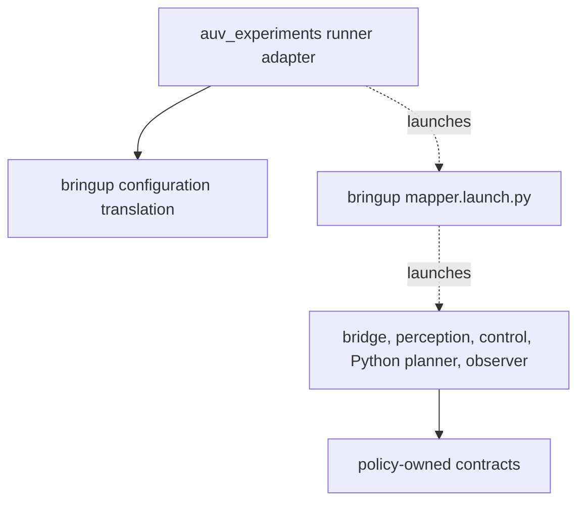

# `bringup` architecture

`launch/mapper.launch.py` is the deployment composition root. It launches `sim_bridge`, `perception`, both `motion_control` executables, `python_planner`, and the `benchmark_evaluator` observer. It does not launch the alternative C++ planner or an Optuna optimizer.

`package.xml` declares launch/runtime dependencies. `setup.py` installs the launch file, both YAML profiles, the active scenario JSON and its parameter reference. Launch names determine which ROS YAML sections apply.

`bringup/configuration.py` owns trial-override translation into deployment YAML: planner values, planner map/output paths and observer output directory. It is pure. `auv_experiments/runner_adapter.py` owns YAML IO/process management and calls that translation, so deployment node keys have one owner.

There is no observer-to-bringup launcher dependency. See the [parameter reference](../../bringup/config/README.md) for arguments, precedence, node names and simulator fields.
