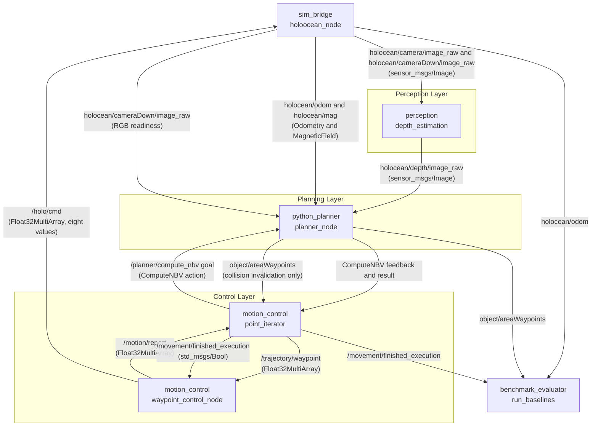
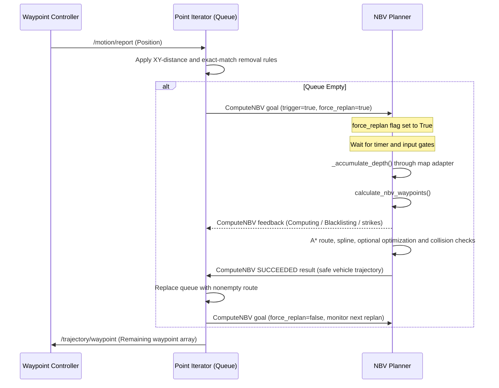

# AUV Exploration Pipeline & Failsafe Mechanics

This documents the default Python NBV planner and C++ trajectory iterator. NBV computation uses an action; all trajectories contain vehicle coordinates in the map frame.

## 1. Node Graph & Topic Map

The following diagram illustrates the active ROS 2 nodes and the specific topics/message types used to communicate during an active exploration mission.

## 2. The Demand Loop (Sequence Diagram)

The queue (`point_iterator`) keeps a monitoring action open while executing a route. When the queue empties, it cancels that pending action and requests an immediate replan. Planning waits for the `0.5 s` timer, odometry, RGB readiness, a new depth frame, timestamped camera TF, and an initial map with at least 40 occupied points. These startup waits preserve the request and consume no strikes. The first usable cloud triggers the pending plan immediately. Feedback and watchdog timeouts expose progress and server failure; the computation timeout runs only during `Computing` or `Blacklisting`, while missing feedback is always monitored.

## 3. Algorithmic Pipeline Breakdown (`use_cases/nbv.py`)

The policy calculates frontiers and information gain versus kinematic cost. `get_NBV.py` remains a compatibility composition facade; Open3D preprocessing belongs to `adapters/point_cloud.py`.

### Phase 1: Pre-Processing & Filtering
*   **Z-Filter:** Keep occupied points with strict `Z > nbv_z_min_target`. The separate `z_min_target` parameter applies during map accumulation.
*   **Voxel Downsample & Outlier Removal:** Uses `Open3D` to compress the point cloud and remove statistical noise, allowing KDTree operations to run in real-time.
*   **Minimum cloud size:** Fewer than 40 retained points stops candidate generation.

### 2. PCA Complexity & Frontier Detection
*   **PCA Complexity:** For every point, a KDTree finds $K$ neighbors. The eigenvalues of the local covariance matrix are computed. The ratio of the smallest eigenvalue to the sum of all eigenvalues determines the "complexity" (roughness) of the surface.
*   **Frontiers:** Tangent-plane neighbor angles identify angular gaps exceeding `frontier_angle_threshold_deg` (e.g., 130°).

### 3. Clustering
*   Frontiers are grouped based on `cluster_fov_radius`. Clusters with fewer than `cluster_min_samples` are discarded as noise. A centroid and average normal vector are computed for each surviving cluster.

### 4. Candidate Generation & Utility Scoring
*   Viewpoints are generated in a cone around the cluster centroid based on `standoff` distance and `polar_angles_deg`.
*   **Information Gain:** Scored using `evaluate_viewpoint`. Rewards looking directly at highly complex (rough) surfaces:
    `Gain = cos(incidence) * (1.0 + complexity_weight * PCA_complexity)`
*   **Kinematic Cost:** Penalizes distance, required AUV rotation, and proximity to obstacles.
*   **Final Utility:** Normalizes Gains and Costs to `[0, 1]`. 
    `Utility = Normalized_Gain - Normalized_Cost`.
*   **Observation history:** The existing distance window and historical-yaw/bearing conditions filter previously observed frontier points. A winner is retained per cluster and sorted by utility.

The mission then routes accepted candidates through `python_planner/route_planning.py`, generates and checks splines, resamples/reconnects, and applies existing safe fallbacks. Optional optimization is a separate step and is disabled in the shipped profile. Wire encoding adds the camera offset and casts to Float32; the adapter reconstructs executed coordinates for the final policy collision check. The queue subtracts the same offset from incoming `[x,y,z,yaw]` groups.

## 4. Failsafe Documentation

Because 3D A* and splining are prone to mathematical dead-ends in tight corridors, the planner employs two critical failsafes.

### A. The Physical Blacklist System
If a failed route identifies a specific target and the cooldown is positive, the planner temporarily bans its coordinate space. Not every failed batch identifies such a target.
*   **Trigger:** `_blacklist_failed_target()`
*   **Action:** The target's `[x, y, z]` coordinate is added to the `blacklisted_targets` list.
*   **Effect:** Any future candidate generated within a `0.5m` radius of this point is instantly dropped.
*   **Cooldown:** The blacklist expires after `blacklist_cooldown_s` (default 30 seconds), ensuring the AUV can attempt the area later from a different angle.
*   **Counter interaction:** A successful target-specific ban does not itself increment the failure counter. Existing bans are refreshed/expired using the injected monotonic clock.

### B. The 3-Strike Rule (Strikeout System)
If the AUV gets stuck in a position where *no* valid candidates can be reached safely, the mission must terminate gracefully rather than looping infinitely.
*   **Trigger:** A failed safe batch that cannot blacklist a specific target, or a batch with no safe candidates remaining, increments `failed_plan_count`.
*   **Reset:** If a trajectory is successfully published, `failed_plan_count` resets to `0`.
*   **Strikeout:** If `failed_plan_count >= 3`, Python sets `finished_mapping = True` and returns ABORTED with `strikeout=true`. C++ transitions to `MissionComplete`, clears its queue, and publishes `/movement/finished_execution` to halt execution. Other aborts, rejection, malformed results, or timeouts transition to `Failed` and halt execution.

### C. Collision cancellation

When newly mapped occupancy blocks the cached route, Python clears it and publishes an empty observer array. C++ clears its queue, holds execution using the existing completion signal, and requests an immediate action replan. Only a successful, validated action result resumes execution. Nonempty observer messages cannot install or duplicate routes.

## 5. Key Configurable Parameters

| Parameter | Shipped YAML Value | Meaning |
| :--- | :--- | :--- |
| `min_utility_threshold` | `0.1` | Higher = AUV becomes picky, moving only for high-value targets. Lower = more exhaustive, slower exploration. |
| `collision_radius` | `0.3` | Safety bubble around the AUV. Higher = safer but prevents navigating tight spaces. |
| `planning_period` | `100` | Accepted mapping iterations between periodic planning attempts, not timer ticks. Internal attribute: `frame_period`. |
| `route_blacklist_cooldown_s` | `30.0` | How long an unreachable target remains banned. |
| `trajectory_continuity_weight`| `8.0` | High values force the A* spline to align smoothly with the AUV's current momentum. |

Collision inflation also includes `collision_tracking_margin=0.4 m`; configured radius plus margin is `0.7 m`. See the [complete parameter reference](../../bringup/config/README.md) for configured/default differences, declared-but-unused values and hardcoded calibration. See [validation/status](../architecture/refactoring_status.md) for tested behavior and runtime limits.
