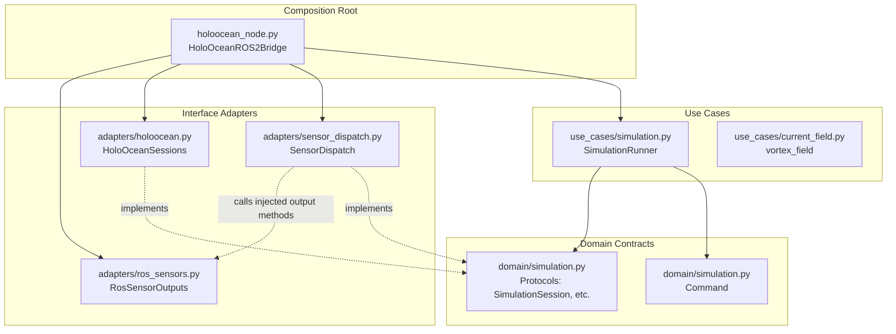

# `auv_sim_bridge` Clean Architecture Documentation

## Overview
The `auv_sim_bridge` package acts as the translation layer between the proprietary HoloOcean simulator and the ROS 2 AUV software stack.

Historically, this package relied on a monolithic ROS 2 Node (`HoloOceanROS2Bridge`) that directly managed the simulator lifecycle, computed environmental physics, parsed raw sensor dictionaries, and published ROS messages. 

To improve testability, maintainability, and hardware independence, the package has been refactored using **Clean Architecture** principles. The core simulation logic is now completely decoupled from ROS 2 and HoloOcean specifics.

---

## Architectural Dependency Graph

The diagram shows source dependencies and labeled runtime calls. `SimulationRunner` imports inner contracts; the composition root supplies concrete adapters. The dotted dispatch-to-output edge calls a supplied object and does not import the ROS output class.

---

## Layer Breakdown

### 1. Domain (`domain/simulation.py`)
**The Inner Ring. Contains pure data structures and abstract interfaces.**

This layer knows nothing about ROS (`rclpy`, `sensor_msgs`) or the simulator (`holoocean`). It defines the vocabulary of the simulation.
*   **Entities:** `Command` is an immutable dataclass representing a vehicle thrust command.
*   **Contracts (Protocols):** `SimulationSession`, `SessionFactory`, `SensorDispatcher`, and `CurrentField`. These define *what* the system needs to do, without specifying *how*.

### 2. Use Cases (`use_cases/`)
**The Middle Ring. Contains application-specific business rules.**

This layer orchestrates the flow of data but relies entirely on the Domain Contracts to execute actions.
*   **`SimulationRunner`:** Opens a session, steps the environment, dispatches sensors and calls an injected event pump. The composition root supplies `rclpy.spin_once`; the use case imports no ROS API. Tests use fake sessions/pumps without a simulator or ROS network.
*   **`vortex_field`:** Pure mathematical policy defining environmental currents based on spatial coordinates.

### 3. Interface Adapters (`adapters/`)
**The Outer Ring. Translates between the Domain and external frameworks/drivers.**

Code here is allowed to import `rclpy`, `numpy`, `cv2`, and `holoocean`.
*   **`holoocean.py`:** Implements the `SessionFactory` and `SimulationSession` protocols, wrapping the proprietary `holoocean.make` API.
*   **`ros_sensors.py` (`RosSensorOutputs`):** Handles all ROS 2 publisher logic. It receives clean Numpy arrays or primitive types and safely packs them into `sensor_msgs/Image`, `nav_msgs/Odometry`, etc.
*   **`sensor_dispatch.py` (`SensorDispatch`):** Uses an ordered handler registry. A new handler can be registered without changing the stepping loop. Each existing sensor keeps its exception handling; location processing applies the injected current field before publishing location. Agent selection is supplied at this boundary, retaining `auv0` by default.

---

## The Composition Root

**`auv_sim_bridge/holoocean_node.py`**

The entry point file is now strictly a **Composition Root**. The `HoloOceanROS2Bridge` class no longer contains simulation math or publishing logic. Its only responsibilities are:
1.  Initializing the ROS 2 Node.
2.  Reading configuration parameters (`holoocean_config.json`).
3.  Instantiating the Adapters (`RosSensorOutputs`, `HoloOceanSessions`).
4.  Wiring the Adapters into the Use Case (`SimulationRunner`).
5.  Starting the execution loop.

`run()` begins after construction in `main`, preserving command/step order without a blocking constructor. Scenario JSON loading and `holoocean.make` are in `adapters/holoocean.py`. Camera metadata and message conversions remain in `RosSensorOutputs`. See the [parameter reference](../../auv_bringup/config/README.md) and [validation report](../architecture/refactoring_status.md).
