# Global AUV System Architecture

## Overview
The active AUV pipelines now separate mission/math policy from ROS 2, simulator APIs, model loading and storage. Policy uses owned contracts; composition roots supply concrete implementations. This document describes the implemented boundaries rather than certifying that every historical audit finding is closed. See the [finding dispositions and validation evidence](../architecture/refactoring_status.md).

Instead, all dependencies point inward toward policy-owned contracts and domain entities.

## Global Dependency Topology

The runtime telemetry/experiment cycle was removed by extracting `auv_contracts`, `telemetry_adapters`, and `auv_experiments`. There are ten ROS packages: the original seven plus those three. The default bringup launches the Python planner; `active_inspection_planner` remains an alternative.

```mermaid
graph TD
    subgraph Composition Root
        BR[bringup] -. launches .-> SB[sim_bridge]
        BR -. launches .-> PE[perception]
        BR -. launches .-> MC[motion_control]
        BR -. launches .-> PP[python_planner]
        BR -. launches .-> BE[benchmark_evaluator]
        EXP[auv_experiments] -. orchestrates .-> BR
    end

    subgraph Interface Adapters
        SB_ADAPT[sim_bridge/adapters]
        PE_ADAPT[perception/adapters]
        MC_ADAPT[motion_control/adapters]
        PP_ADAPT[python_planner/adapters]
        BE_ADAPT[benchmark_evaluator/adapters]
        AIP_ADAPT[active_inspection_planner/adapters]
        TEL[telemetry_adapters]
    end

    subgraph Core Use Cases
        SB_UC[sim_bridge/use_cases]
        PE_UC[perception/use_cases]
        MC_UC[motion_control/use_cases]
        PP_UC[python_planner/use_cases]
        BE_UC[benchmark_evaluator/use_cases]
        AIP_UC[active_inspection_planner/use_cases]
    end

    subgraph Shared Domain & Contracts
        CON[auv_contracts]
        SB_DOM[sim_bridge/domain]
        PE_DOM[perception/domain]
        PP_DOM[python_planner/domain]
        BE_DOM[benchmark_evaluator/domain]
        MC_DOM[motion_control/domain]
        AIP_DOM[active_inspection_planner/domain]
    end

    %% Dependency arrows (always pointing inward)
    SB_ADAPT --> SB_UC
    PE_ADAPT --> PE_UC
    MC_ADAPT --> MC_UC
    PP_ADAPT --> PP_UC
    BE_ADAPT --> BE_UC
    AIP_ADAPT --> AIP_UC

    SB_UC --> CON
    SB_UC --> SB_DOM
    PE_UC --> CON
    PE_UC --> PE_DOM
    PP_UC --> CON
    PP_UC --> PP_DOM
    BE_UC --> CON
    BE_UC --> BE_DOM
    TEL -. implements .-> CON

    MC_UC --> MC_DOM
    AIP_UC --> AIP_DOM
    EXP --> CON
    EXP --> BE
```

Solid edges summarize aggregated source dependencies; dotted edges show launch/orchestration or structural protocol implementation. Adapters also depend directly on domain contracts. This is not a ROS topic graph; see [runtime mechanics](exploration_pipeline_mechanics.md).

## The Three Rings of the System

### 1. The Inner Ring: Domain Entities & Contracts
This ring contains no framework dependencies. It represents the absolute core truths of the AUV system.
* **`auv_contracts`:** A shared Python package defining pure `Protocol` interfaces (e.g., `TrajectorySink`, `Clock`, `OccupancyMap`) and immutable `dataclass` values (e.g., `PoseSample`, `Trajectory`).
* **`motion_control/domain` (C++):** Defines `ControlConfig`, `MotorCommand`, and pure virtual interfaces like `ThrusterMixer` and `CommandOutput`.
* **`active_inspection_planner/domain` (C++):** Defines immutable image/config/pose values, map/spatial-index ports, `VoxelIdx`, and `SearchPolicy` mathematics. Eigen remains a mathematical dependency.

### 2. The Middle Ring: Use Cases
This ring contains the application-specific business logic. It orchestrates data flow using the interfaces defined in the Inner Ring.
* **`python_planner/use_cases`:** Calculates Next-Best-View (NBV), optimizes trajectories, and manages the inspection mission state machine.
* **`motion_control/use_cases`:** Computes PID control laws and manages the active waypoint queue.
* **`benchmark_evaluator/use_cases`:** Evaluates nearest-planned-sample trajectory error and map-distance RMSE / coverage against ground truth.

### 3. The Outer Ring: Interface Adapters & Frameworks
This ring interacts with the outside world. It translates ROS 2 messages, disk files, and external APIs into the pure data formats required by the Use Cases.
* **ROS 2 Nodes:** E.g., `planner_node.py`, `waypoint_control_node.cpp`. These simply unpack `sensor_msgs` or `nav_msgs`, pass data to Use Cases, and pack the results back into messages.
* **Framework Adapters:** `adapters/bgnet.py` (PyTorch), `adapters/octomap.py` (pyoctomap), `adapters/holoocean.py` (Simulator API).
* **`telemetry_adapters`:** Concrete implementations of the logging contracts (writing to JSONL/CSV).
* **`auv_experiments`:** Optuna process runner that overrides configurations and spins up the system without injecting experiment logic into the core planner.

## Composition, builds and documentation

`bringup/bringup/configuration.py` owns translation from trial parameters to deployment YAML keys. `auv_contracts/mission_results.py` owns the existing mission-result filename/text convention shared by the observer and trial runner. The format remains unchanged.

The C++ libraries are `motion_policy`, `motion_platform_adapters`, `inspection_policy`, and `inspection_map_adapters`. ROS executables compose them; the two policy libraries build without ROS headers. Python domain/use-case imports are checked for framework and IO leaks. Compatibility facades are outer entry points and may construct default adapters.

Start with the [documentation index](README.md), [bringup architecture](bringup_architecture.md), and [complete parameter reference](../../bringup/config/README.md). Validation covers all ten package builds, Python policy/regression checks, C++ policy tests and a baseline mapping comparison. It does not replace a full HoloOcean/Torch mission replay.
